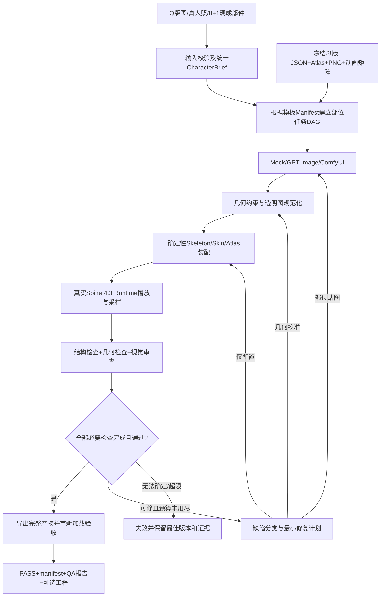

# Spine Skin Tool — Codex 工程实施总规范 v1.0

> **用户确认的执行修订（里程碑 1）**：下文所有 382×378 等尺寸只记录已有素材的观测值，不能视为最终生产设定。实验配置入口为 `runtime/config/size-trials.toml`；分别管理生成原图分辨率、导出贴图画布和 Spine 几何/锚点。每次试验锁定参数与哈希，经过多次生成、装配、播放和人工认可后再批准生产规格，后续可版本化修订。执行安排以 `docs/plans/MILESTONES.md` 为准：简易预览提前，受控的人工验收生图试验先于完整自动 QA；付费和上传仍须单独授权。

> **当前用户确认贴图契约（2026-11-01）**：以 `docs/TEXTURE_CONSTRUCTION_BASELINE.md` 与 `generation.py:build_part_prompt` 为完整现行规则，替代本文旧通用生图建议。原头模/表情复用，原耳所有状态隐藏；现行standard-ear-001固定无耳前后发的头模贴合与整体高度，以共同头局部耳根补标准简约小耳，不重新生成头发或人物。原照两侧耳均被头发遮住才隐藏小耳；任一侧可见或不明时补一对。历史013的AI耳部阶段仅作为旧候选追溯，不是当前默认。头发重生仍从原真人照片与原参考出发。Harri 定义无肩衣身、肩部归 ARM、长筒四肢和半圆无指手；Davide/Spineboy 辅助统一画风。BODY碗形下沿与LEG裤色大致协调即可，不追求细小色差一致。正面/侧面顺序为腿→衣身/裙子→手臂→头部组，背面为腿→手臂→衣身/裙子→头部组。原耳在全部方向/表情/过渡中隐藏，小耳在后续阶段合成进对应前后发并部分夹在头发里，肤色/线条协调固定头模；腕配色保留袖色深线与深肉色线两类。后发完整覆盖后脑，简洁连续无头皮/拼贴纹理，生成后同头部尺度比较正背轮廓。当前共享设计契约/唯一装配入口见 docs/SHARED_CHARACTER_FLOW.md，聊天三角色试验见 docs/CHAT_VALIDATED_FLOW.md；默认标准腕配色明确记为非AI，未拍到衣装可自由设计。尺寸仍为实验值。

> **项目类型**：独立的固定 Spine 母版 AI 角色生成、套皮、播放审查、有限返修和导出工具。
>
> **阅读顺序**：本文件第 0 章是最高优先级工程约束；Codex 每次开工先读仓库根目录 `AGENTS.md`，再读当前任务卡、相应设计章节与 `docs/changes/CHANGELOG.md` 最近记录。
>
> **文档状态**：实施规范 / 设计决策提案（不是“工具已经实现”的证明）。资料核对日期：2026-10-30（Asia/Tokyo）；工具链具体版本、模型可用性、许可证与现场性能在执行阶段重新核实。
>
> **事实来源**：用户上传的 `SPINE_SKIN_TOOL_PROJECT.md`、此前审查补全文档、`chibi-stickers-pro.spine`、`chibi-stickers.json`、22 张 `chibi-stickers*.png`、`test.zip`（含 `ai-city-original-template.json/.atlas` 和 9 张模板图片）；外部技术依据在附录给出官方链接。文中以【原文要求】【实际文件证据】【设计决定】【待验证】区分信息层级。
>
> **当前任务范围**：实际进度以 plans/MILESTONES.md 及各任务卡为准：M01～03已完成历史任务范围，M04-06/07共享设计/全身核心已完成，M04-05美术/规格仍待审，M05审核/动作图证/订阅视觉辅助与M05-05现行规范对照校准已验收（见docs/REVIEW_PIPELINE.md与REVIEW_CALIBRATION.md，自动美术放行仍关闭），M06有限返修/持久恢复已实现且有限实测有效，额度复核后总体为IMPLEMENTED / NOT FULLY VALIDATED（M06-05故障覆盖不完整）（见REPAIR_PIPELINE.md与evidence/M06.md），M07统一编排与授权的新增照片设计/整套生成/246帧/有限返修已有实测，最终闭环与剩余质量以CHARACTER_PIPELINE.md及evidence/M07-LIVE.md为准，M08已于2026-11-04由用户明确验收通过并标记COMPLETE，未实测事项保留为后续边界；当前交付状态见docs/RELEASE_STATUS.md，执行TASK-M08-RELEASE（干净交付、仓库references/spine原参考与运行母版对齐、本人登录启动、白名单打包发布；当前操作先读根使用说明与RELEASE_STATUS）；原照左右均被头发遮挡才可HIDDEN，否则补小耳对，固定前后共同耳根、每只至少40%可见，不移动或重画头发。014单角色持续会话、部件作用域、侧颊/发鬓分审及现行耳部规范以QUALITY与TEXTURE_CONSTRUCTION_BASELINE当前节为准。早期里程碑1只建设基础配置的范围属于历史，不是当前工具状态。不直接调付费 API，不修改原始母版，不宣称已自动生成合格角色。任何付费模型、云上传、凭据、外部发布、Git push 必须得到用户明确授权。

---

# 0. 最高优先级：版本、运行环境、依赖、缓存、更新日志与开发纪律

> 本章为**强制规范**；所有其他章节、任务卡、代码生成决定不得绕过。`runtime/` 是本地开发/运行时的统一入口，不是将应用源码和生成物混为一谈的文件夹。所有依赖声明、版本锁定和依赖安装入口放在 `runtime/`；业务源码、文档、母版配置和已批准测试样例与它分离。

## 0.1 三层隔离原则与目录归属

1. **受版本控制的产品层**：`src/`（核心业务 Python 源码）、`ui/`（只存原生 UI 源码）、`templates/`（被批准的母版规则与清单）、`prompts/`、`schemas/`、`tests/`、`fixtures/`（许可允许的非私人样例）、`docs/`、`scripts/`、`AGENTS.md`。其中的文件修改必须写变更记录。
2. **受版本控制的运行契约层**：`runtime/versions.toml`、`runtime/python/pyproject.toml`、`runtime/python/uv.lock`、`runtime/js/package.json`、`runtime/js/pnpm-lock.yaml`、`runtime/config/*.example.*`、`runtime/README.md`、`runtime/license-manifest.json`。版本号、包管理器、安装方式、原生组件/Spine Runtime 版本在这里集中定义；锁文件是受控代码资产。
3. **不进入 Git 的本机物理环境与数据层**：`runtime/python/.venv/`、`runtime/js/node_modules/`、`runtime/cache/`、`runtime/tmp/`、`runtime/work/`、`runtime/data/`、`runtime/logs/`、`runtime/output/`、`runtime/secrets/`、`runtime/bin/`、`runtime/vendor-untracked/`。这些目录只有明确授权的维护脚本可以清理，用户交付物和中断任务数据不可当缓存随意删除。

**理由**：源代码可克隆、可审阅、可复现；依赖可以从锁文件重建；缓存和私有用户资料可删/迁移而不污染 Git。用户要求的“统一 runtime”必须落实到依赖声明和安装位置，而不只是文档中写一个文件夹名。

## 0.2 唯一推荐仓库结构（目标形态，尚未建设）

```text
spine-skin-tool/
├── AGENTS.md                       # Codex 自动读取的短规则（必须存在）
├── README.md                       # 用户入口；指向本文与启动命令
├── .gitignore
├── .gitattributes
├── src/spine_skin_tool/
│   ├── __init__.py
│   ├── cli.py                       # 纯本地命令行入口
│   ├── config.py                    # 配置加载与严格校验
│   ├── api/                         # FastAPI 本地 API，可延后
│   ├── domain/                      # 数据结构、枚举、Pydantic 契约
│   ├── orchestrator/               # 有限状态机、工作队列、重试、预算
│   ├── template/                   # JSON/atlas/图片母版解析与冻结
│   ├── inputs/                     # Q 版、照片、固定贴图输入适配器
│   ├── generation/                 # GPT Image / mock / ComfyUI 接口
│   ├── imaging/                    # Pillow / OpenCV 部位规范化
│   ├── assembly/                   # JSON/atlas/贴图确定性装配
│   ├── render/                     # 调用版本固定的渲染进程
│   ├── review/                     # 规则、几何、视觉审查
│   ├── repair/                     # 分类、返修计划、候选比较
│   ├── export/                     # runtime bundle、可编辑工程可选
│   ├── persistence/                # SQLite、工件索引、迁移
│   └── observability/              # 事件、统计、脱敏日志
├── ui/                              # HTML/CSS/轻量 TS 源码（可晚建）
├── templates/chibi-4.3-beta/
│   ├── template.yaml               # 本项目唯一首期母版规则
│   ├── slots.yaml                  # 保留/替换、显隐/层级规则
│   ├── assets.yaml                 # 8 张主图片+blank 的尺寸/命名
│   ├── animation-matrix.yaml       # 动作、关键帧、测试维度
│   ├── geometry.yaml               # 锚点/遮挡区/容差：需实测填充
│   └── baseline.sha256             # 用户批准基线哈希
├── schemas/                         # Pydantic 模型导出的 JSON Schema
├── prompts/                         # 有版本的生成、审查、局部返修提示词
├── fixtures/
│   ├── golden/                      # 用户认可且许可可保留的参考案例
│   ├── defects/                     # 带预期判定的缺陷案例
│   └── synthetic/                   # 无私人信息、可重复的样例
├── tests/unit/  tests/integration/  tests/e2e/
├── scripts/
│   ├── bootstrap.py                 # 环境准备入口；不写全局目录
│   ├── doctor.py                    # 自检依赖/Spine 版本/文件权限
│   ├── verify_changes.py           # 强制校验本次变更与日志覆盖
│   ├── sync_changelog.py           # 从当前机器记录同步真实代码片段到Markdown
│   ├── record_change.py            # 生成变更记录草稿 + 代码定位
│   └── clean_runtime.py            # 仅清理明确可删除的缓存
├── docs/
│   ├── CODEX_IMPLEMENTATION_SPEC.md # 本文仓库内副本
│   ├── ARCHITECTURE.md              # 高层边界与依赖方向
│   ├── DECISIONS.md                 # ADR 索引
│   ├── plans/                      # 原子任务卡 / 实施进度
│   ├── changes/
│   │   ├── CHANGELOG.md             # **每次修改必维护**
│   │   └── entries/                # 每任务结构化变更记录 .json
│   ├── evidence/                   # 仅非私人、可提交的核验摘要
│   ├── OPS.md                      # 安装、备份、恢复、清理、故障处理
│   └── QUALITY.md                  # 已校准的质量标准
└── runtime/
    ├── README.md                   # 所有环境管理的单一说明入口
    ├── versions.toml               # 唯一版本决策目录：工具、协议、母版、Spine、Python、Node等
    ├── license-manifest.json       # 第三方运行组件及许可审计
    ├── python/
    │   ├── pyproject.toml          # Python 依赖声明（受控）
    │   ├── uv.lock                 # Python 依赖完整锁定（受控）
    │   └── .venv/                  # Python 虚拟环境（忽略）
    ├── js/
    │   ├── package.json            # 浏览器 Spine 播放/截图执行器依赖声明
    │   ├── pnpm-lock.yaml          # JS 依赖完整锁定（受控）
    │   ├── .npmrc                  # 仅稳定且受验证的 pnpm 本地配置
    │   └── node_modules/           # JS 依赖（忽略）
    ├── config/defaults.toml        # 安全默认值（受控）
    ├── config/local.example.toml   # 本地覆盖示例（受控）
    ├── config/local.toml           # 本地覆盖实际值（忽略）
    ├── secrets/                    # API key / token，**永不提交**
    ├── bin/                        # 外部可执行程序及工具检测结果（忽略）
    ├── vendor-untracked/           # 依法下载/安装的 Spine 组件（忽略）
    ├── work/jobs/<job_id>/         # 每次执行的独立中间工件（忽略）
    ├── data/                       # SQLite + 持久化数据（忽略；不得误删）
    ├── output/                     # 完成的交付品（忽略；不得误删）
    ├── cache/                      # 可重建的模型/图片/浏览器缓存（忽略）
    ├── tmp/                        # 可安全回收的临时文件（忽略）
    └── logs/                       # 脱敏运行日志（忽略）
```

**注意**：Node/JS 仅服务于 Spine Runtime 浏览器真实动画渲染；绝不为了两个脚本随意再起一个全功能 Node 后端。Spine Editor 本体为独立授权工具，不把它误称为 npm 包。原则上要求 `runtime/` 仍可用 `git clone` 完整恢复其规范，但不能要求把本地许可证和付费软件打入仓库。

## 0.3 版本唯一来源与升级策略

由 `runtime/versions.toml` 保存下列字段。**不得在源码常量、提示词、UI 与文档中再独立维护一套真实版本号**；运行时从版本文件读取；测试校验所有关联字段相符。

```toml
# 示例 schema；下面的示意值不能代替安装验证
[product]
version = "0.1.0"            # SemVer: MAJOR.MINOR.PATCH
api_schema = "1.0.0"
job_schema = "1.0.0"
asset_schema = "1.0.0"
quality_policy = "quality-mvp-001"

[toolchain]
python = "3.12"             # 首次环境安装时解析并锁定可用补丁版
uv = "PIN_AFTER_VERIFICATION"
node = "PIN_AFTER_VERIFICATION"
pnpm = "PIN_AFTER_VERIFICATION"

[spine]
editor_export = "4.3.75-beta"    # 上传 JSON 中可核验的导出版本
runtime_major_minor = "4.3"      # 官方要求 major.minor 匹配
runtime_commit = "PIN_AFTER_VERIFICATION"
template_id = "chibi-4.3-beta"
template_revision = "mvp-template-001"

[models]
image_provider = "openai"
image_model = "PIN_SUPPORTED_MODEL_AT_INTEGRATION"
image_prompt_revision = "image-prompt-001"
review_provider = "openai"
review_model = "PIN_SUPPORTED_MODEL_AT_INTEGRATION"
review_prompt_revision = "review-prompt-001"
```

- 所有 `PIN_AFTER_VERIFICATION` 必须在相应阶段开始前换成真实且可复现的版本；如果没锁定则 `doctor` 拒绝生产模式，但**不能阻止纯 mock 的第一阶段开发**。
- Spine JSON 已注明 `4.3.75-beta`，因此不能随意拿 4.2 或 4.1 Runtime 读取。beta 版本尤其要做最小播放兼容性验证，必要时先选一个明确可重现的 Spine 4.3 Runtime 提交/构建版本。【实际文件证据】与官方版本匹配规则。
- `product.version`：PATCH 修 bug；MINOR 加兼容功能；MAJOR 破坏公开接口。`template_revision`、`asset_schema`、`quality_policy` 和提示词版本单独升级，不能用产品版本覆盖。
- 母版骨骼、Slot、动作基线与 drawOrder 改变属于**母版修订**；不能在单个用户角色任务中临时修改基线。
- 升级依赖必须写受影响功能、迁移方式、回滚方案、测试结果、更新日志；安全修复紧急升级同样留痕。

## 0.4 Python 虚拟环境与依赖锁定

**设计决定**：Python 3.12 系列 + `uv` 为核心端；依赖声明 `runtime/python/pyproject.toml`，锁文件 `runtime/python/uv.lock`，实际环境 `runtime/python/.venv/`。`runtime/python/` 是 uv 项目根；应用源码在根目录的 `src/`，通过启动包装器配置 `PYTHONPATH=<repo>/src`，避免向源码目录写环境文件。`pyproject.toml` 首期设置 `[tool.uv] package = false`，否则包目录与 pyproject 的分离需另行配置构建。

```bash
# 下列命令由 scripts/bootstrap.py 包装并做跨平台处理；仅展示含义
uv lock --project runtime/python
uv sync --project runtime/python --locked
# 从仓库根执行：在包装脚本里把 PYTHONPATH 设置为绝对 <repo>/src
uv run --project runtime/python --locked python -m spine_skin_tool.cli doctor
```

- `uv` 默认虚拟环境位于项目根 `.venv`；因为 uv 项目根是 `runtime/python`，实际落在 `runtime/python/.venv`。必要时可显式用 `UV_PROJECT_ENVIRONMENT=<repo>/runtime/python/.venv`。不要把它指向全局 Python。
- uv 下载缓存在 `runtime/cache/uv`：包装器设置 `UV_CACHE_DIR=<repo>/runtime/cache/uv`。
- Python 字节码缓存通过 `PYTHONDONTWRITEBYTECODE=1` 关闭；测试工具缓存（pytest/ruff）通过参数或配置指向 `runtime/cache/`。
- 依赖变更只能修改 `runtime/python/pyproject.toml`，然后更新 `uv.lock`；重建用 `uv sync --locked`；**禁止用 `pip install` 临时污染环境**，更不能把依赖安装到系统级 Python。
- 推荐初始依赖：`pydantic`（结构化契约）、`pydantic-settings`（配置）、`Pillow`（透明 PNG）、`numpy`（图像数组）、`typer`（CLI）、`rich`（本地日志）、`httpx`（HTTP client）；可选阶段引入 `opencv-python-headless`（图像/遮罩操作）、`fastapi/uvicorn`（UI API）、`openai`（GPT Image/视觉模型）、`pytest`/`ruff`/`mypy`（测试工具）。**具体版本让首次依赖评估任务选定并生成锁文件，不假装已经验证一组随意写出的组合**。
- GPU/ComfyUI 不并入基础 Python venv；作为额外的可选生成适配器，其模型权重、虚拟环境、显存依赖置于 `runtime/vendor-untracked/comfyui` 或由配置提供外部 URL；不让 GPU 包污染可在 CPU 上运行的主工具。

## 0.5 Node、浏览器渲染与第三方组件隔离

- `runtime/js/package.json` 和锁文件是**唯一** JS 依赖清单；`runtime/js/node_modules` 为安装位置。可用 `pnpm --dir runtime/js install --frozen-lockfile` 安装依赖；CI 同样只能读取锁文件。
- 初期只需要浏览器端 Spine 4.3 Runtime、自动播放/截图执行器和必要的构建器；优先通过 `runtime/js/` 中的驱动脚本调用浏览器中的 `ui/renderer/` 代码。构建时显式指定工具脚本的工作目录、包解析根和输出目录，不能依赖“从任意位置执行刚好找得到 node_modules”。
- Playwright 浏览器下载也必须被纳入 `runtime/cache/playwright/`（设置 `PLAYWRIGHT_BROWSERS_PATH`）；每次截图使用一致浏览器版本、像素比、抗锯齿及 viewport。
- Spine Runtime 必须核查许可要求、版本及来源；仅在被许可时保存第三方源码或分发二进制；许可证信息写进 `runtime/license-manifest.json`，额外资源/下载产物不提交 Git。
- 不要假设 `.spine` 是可直接编辑的 JSON。需要真正的编辑器项目时，调用**经许可且经版本验证**的 Spine Editor/CLI，并重新打开或导出检查；暂时无法提供时，明确报 `EDITOR_PROJECT_UNAVAILABLE`，不能把运行 JSON 改名为 `.spine`。

## 0.6 数据安全、缓存、持久化与路径规则

| 类型 | 位置 | 是否可由自动清理删除 | 是否进入 Git |
|---|---|---|---|
| 临时裁剪、网络下载重试缓存 | `runtime/tmp`, `runtime/cache` | 是（任务没有引用时） | 否 |
| 正在生成的候选版本、每次模型输出、评审证据 | `runtime/work/jobs` | 只在明确保留期后、安全检查后 | 否 |
| SQLite 状态数据库、任务索引、已批准角色引用 | `runtime/data` | **否**，必须备份/迁移 | 否 |
| 正式交付包 | `runtime/output` | **否**，必须用户主动删除或策略授权 | 否 |
| API key、照片、隐私输入 | `runtime/secrets` 或每任务私有目录 | 依据同意与保留期 | 否 |
| 母版配置、已脱敏 fixture、提示词 | `templates`, `fixtures`, `prompts` | 否 | 是（需合法授权） |

- 路径必须从项目根和配置解析，不能硬编码开发者个人目录、Windows 盘符或云地址；防止 `../` 目录穿越和任意文件覆盖。
- 图片、模型中间产物按 `job_id/candidate_id/part_id` 整理。生成原始图与规范化图永远是两个文件；不得覆盖唯一原稿。
- 使用写入临时文件 + `fsync` + 原子重命名，数据表使用事务。中断后能够从已完成阶段恢复。
- 工作目录不能直接从公网提供；上传图有限制大小、解码和像素数，日志脱敏，任何人像不得默认成为测试集。
- 清理脚本只允许删除 `runtime/cache`、`runtime/tmp`，其他目录默认 dry-run。迁移部署时保留 `data/output` 和用户批准的 `work`。

## 0.7 【最高强制】Codex 每一次改动必须维护更新文档

**这不是“建议写 CHANGELOG”**，而是每个改变仓库文件的任务的完成门槛。适用于源码、测试、配置、依赖、模板、提示词、任务卡、文档，以及修复上次失败测试所做的追加改动。即使只改一行、只改 Markdown、或一次失败的修复尝试，也要追加记录。任何任务**在日志没有维护并校验通过之前，不得标记为 COMPLETE**。

固定文件：`docs/changes/CHANGELOG.md`（面向人阅读，永不覆盖旧记录）及 `docs/changes/entries/<UTC时间戳>-<task_id>.json`（机器核验；每个实际修改批次一条记录）。

**每条记录必须包含以下信息**：

1. **完整时间**：`2026-10-30T01:23:45+09:00` 这种含时区的 ISO 8601；还保存等价 UTC；绝不能把会话日期猜成实际执行时间。
2. **任务 ID + 本次批次 ID**，变更类型 `ADD/MODIFY/DELETE/RENAME/DEPENDENCY/DOC/TEST/FIX`，关联计划阶段与用户需求。
3. **本次所有改动文件的精确相对路径**，逐一列出；新增/删除/改名要注明；不能只写“修改了几个文件”。
4. **对应的代码位置和代码**：对每个源码改动写函数/类/配置键、修改后的行号范围、`git diff` 中相应修改片段（通常最小相关 3–20 行）或明确的局部代码摘录；不得只写“优化逻辑”。文档和二进制文件要写章节/资源键、前后哈希及原因，注明 `not_applicable` 而非伪造代码片段。
5. **为什么改、预期行为是什么、实际行为是什么**；如有兼容性/接口/数据格式变化，说明迁移与回滚。
6. **实际运行过的验证命令、退出码、结果与证据路径**；没运行的必须写 `NOT_RUN` 和原因，绝不补写虚构通过。
7. **状态**：`COMPLETE / PARTIAL / BLOCKED / FAILED`；已知问题、未完成项目、下一步和回滚引用。

**日志格式范例**（仅为格式示例，不代表已经执行）：

```markdown
### 2026-10-30T01:23:45+09:00 | TASK-P02-04 | BUILD-0007 | PARTIAL
- UTC: 2026-10-29T16:23:45Z
- 目标：增加背向面部 slot 显隐检验。
- 原因：参考成果中背向显示规则需按骨架动作实际验证。
- 文件与对应代码：
  - MODIFY `src/spine_skin_tool/review/visibility.py:check_back_face_slots`，变更后 42–71 行：新增在背向动作快照中核对 eye/eyebrow/mouth/blush 的 attachment 是否为空。
    ```python
    # 修改后的关键片段（实际执行时从已更改代码自动取材）
    if orientation == "back" and visible_expression_slots:
        defects.append(make_defect("BACK_FACE_VISIBLE", visible_expression_slots))
    ```
  - ADD `tests/unit/test_visibility.py:9–65`：覆盖背向可见和正确隐藏两种输入。
- 验证：`...pytest tests/unit/test_visibility.py`，退出码 0；日志 `runtime/logs/...`。
- 风险：尚未做实际 Spine Runtime 录屏验收。
- 下一步：补充 movement/trot-back 两个 drawOrder 时刻的动态测试。
```

**强制自动校验机制**：

- `scripts/record_change.py`：收集 `git diff --name-status`、`git diff --cached --name-status`、新增未跟踪文件，自动列出文件和 hunk；生成待填写的 `CHANGELOG` 与对应 JSON 草稿，**必须由 Codex 填写代码定位、原因和真实测试证据**。自动收集不等于自动验收。
- `scripts/sync_changelog.py`：将当前机器条目中的**真实代码片段**同步到 `CHANGELOG.md` 对应时间戳段落；仅允许更新本次尚未合并的条目，已合并历史只能追加更正条目。
- `scripts/verify_changes.py`：严格比对本次变更涉及文件和 `entries/*.json` 记录的文件集合，要求**双向覆盖**，不能漏掉任何文件；源码改动必须有对应 `symbol/line_range/code_excerpt` 或可核验 hunk，**且同一批次的 Markdown 更新段落必须包含精确代码摘录**；验证时间时区、任务 ID、测试证据、状态。
- **日志自身文件是元数据**：`docs/changes/CHANGELOG.md` 与本批次 `entries/*.json` 不要求再互相递归登记，但验证器必须核对本次日志条目本身存在且格式正确。
- 装入本地 Git `pre-commit` / `pre-push` 检查以及 CI 的强制工作流；未通过日志校验时不能合并。对本机单次编辑在最终汇报前也必须执行，即使用户没有要求提交 Git。
- 为防“Codex 改日志本身后没写日志”，只允许使用 `record_change` 以追加方式写变更记录，允许修正本次尚未验收的条目，但验收后的历史条目不可随意重写。更正旧历史必须再追加 `CORRECTION` 条目。
- 若 `git diff`、文件扫描或日志校验失败，最终状态为 `BLOCKED`，不能说“已完成”。不得使用 `--no-verify` 绕过检查，除非用户明示批准并记录。
- `record_change` 对密钥、token、真实人像内容只收集相对路径、符号和安全摘录；**不要**把秘密或私人图片编码/内容复制到 Git 变更日志。

> **落地现实边界**：`AGENTS.md` 能约束 Codex 工作行为，但单靠提示词不能在技术上保证每次都遵守。要以 `verify_changes.py` + Git hook + CI 三层工程检查强制执行；本规范要求后续先实现并测试这些机制。

## 0.8 每个 Codex 回合统一 SOP

1. 从 `AGENTS.md` 读取最高规则；确认当前任务卡和当前版本；观察 Git 工作区是否有别人尚未提交的变化。
2. 复述本次目标、允许改动文件、明确禁止修改区、计划运行的验证命令；高风险操作事前确认。
3. 先给相应模块补失败测试/fixture，再写最小实现；改动范围尽量控制在一个可复核的任务内。
4. 运行指定测试，审阅 `git diff`，排除无关文件、临时资源和秘密。
5. **立即追加更新日志**：时间、所有改动文件、代码位置/片段、理由、测试结果、下一步，并用 `sync_changelog.py` 同步真实代码片段到 Markdown 段落。
6. 执行 `verify_changes.py`，直到覆盖检查通过；必要时重跑相关测试。
7. 最终汇报固定为：任务 ID、改动文件、实现要点、执行命令与结果、日志记录位置、已知局限、下一任务。
8. 不跨越阶段验收闸门；没有用户许可不调用付费模型、不将真人照片上传、不安装/授权商业工具、不推送远程仓库。

---

# 1. 目标、阶段划分与真实需求

## 1.1 目标产品

【原文要求】这是独立工具；用户可输入真人照片或 Q 版人设，最终用固定 Spine 骨架、动画与表情体系做角色外观的替换，自动发现错误、有限返修、导出。AI City 只需要未来对接输入/输出接口，不是第一阶段运行时依赖。

【用户近期确认】质量标准是“没有**明显**穿模、主要动作大致对上、整体外观达到现有人工制作参考版的满意程度”，不是所有视角、所有表情、所有服装达到精修极致。将这条宽容度落实为**限定范围内的可操作质量策略**，而不是随意打低分放过硬错误。

【分阶段】
- MVP-A：给定**已存在的正背面贴图**，自动装配、真实播放、导出 runtime bundle；质量验收的基准通过人工认可。
- MVP-B：Q 版参考 → GPT Image 生成候选部位 → MVP-A 装配 → 自动审查 → 单部位/单组有限返修。第一版明确只支持经过测试的短发/普通上衣/常规下装；复杂造型返回不支持或已批准简化。
- MVP-C：真人照片 → 特征摘要与前后面设定 → 复用 Q 版流程；之后再做 ComfyUI、自定义表情和更多服装母版。

**非目标**：AI 直接创造任意新骨架、自动雕刻新网格和新动作；任意尺寸图片不受约束可装入；在没有 Spine Editor 的机器上伪造可编辑 `.spine`；保证 100% 永不失败；为 AI City 实现云端入场、游客账号和城市逻辑。

## 1.2 “自动完成”的精确定义

- 自动化任务能在被支持的输入范围中自主 `PASS` 或自主 `FAIL`，并记录原因。`FAIL` 是合格的系统行为，不得让系统为了报告成功持续修改评分标准。
- 候选版本必须保持可追踪：`candidate-0001` 等不可重写，所有返修产生新版本，并记录父版本和修改的部位。
- 每次修复后必须复验完整**受影响的动作集合**；最后导出的是**通过验收的构建**，不是未测试的最后一张图。
- 质量策略有 `HARD_FAIL`（文件/逻辑错误）、`VISUAL_MAJOR`（明显穿模）、`VISUAL_MINOR`（允许但记录）、`UNKNOWN`（缺证据，不能 PASS）四类，并经过真实样例校准。

# 2. 已上传素材的“已验证事实”与“待验证项”

## 2.1 原始母版资产

| 资产 | 已核实内容 | 可用于 | 尚不能证明 |
|---|---|---|---|
| `chibi-stickers-pro.spine` | 约 54 KB 的 Spine 编辑器二进制工程；非 JSON/zip | 版本匹配的 Spine Editor 打开、编辑器成果导出 | 当前环境未通过 Editor 打开，不证明与 JSON 文件逐字一致 |
| `chibi-stickers.json` | `skeleton.spine=4.3.75-beta`；44 bones、62 slots、11 skins、40 animations | 自动解析、骨骼/slot/动画/skin 基线 | 单独 JSON 不能证明全部贴图渲染通过 |
| `chibi-stickers*.png` / `chibi-stickers-pma*.png` | 普通版和 PMA 命名贴图各 11 页，共 22 张 | 纹理资源校验、绘制风格提取 | 不能将 PMA 与普通 alpha 版本混用而不验证渲染参数 |
| `test.zip` | 参考构建含 `ai-city-original-template.json`、`.atlas`、8 张正背主图 + blank | 现实可行的 8+1 输入输出基线 | 这仍是人工修复成果，不代表自动生成工具已存在 |

原 JSON 动作：`movement/idle-{front,back,left,right}`、`movement/trot-{front,back,left,right}` 共 8 个，另有 `emotes/*`、`interactive/*`。参考构建新增名为 `ai-city-original-template` 的 Skin；其自定义 attachment 包含前/后 body、arms、legs、head。

## 2.2 从 test.zip 取得的参考尺寸观测（不是最终契约）

| `part_id` | 用户参考图名 | 观测像素（宽×高） | 装配槽位 | 首期处理原则 |
|---|---|---:|---|---|
| HAIR_FRONT | `ai-city-template-hair-front.png` | 289×240 | `hair-front/hair-front` 原 mesh | 仅发丝；头模、耳朵和表情沿用原素材 |
| HAIR_BACK | `ai-city-template-hair-back.png` | 315×282 | `back-hair/back-hair` 原 mesh | 仅后发；不得烘焙脸部或头模 |
| BODY_FRONT | `ai-city-template-body.png` | 140×195 | `body/body` 的原有 mesh 对应外观 | 连续圆弧/碗形衣摆；裤装上部色块可与衣摆连成一体 |
| BODY_BACK | `ai-city-template-body-back.png` | 140×195 | `body/body-back` | 正背衣服与衣摆相符；无袖筒、手臂或裤腿 |
| ARM_FRONT | `ai-city-template-arm.png` | 55×179 | `arm-l/arm`、`arm-r/arm` | 袖段、手臂和手独立；左右镜像需实装验证 |
| ARM_BACK | `ai-city-template-arm-back.png` | 55×179 | `arm-l/arm-back`、`arm-r/arm-back` | 背面袖口与躯干接缝 |
| LEG_FRONT | `ai-city-template-leg.png` | 57×201 | `leg-l/leg`、`leg-r/leg` | 裤装时裤腿画入腿层；鞋随骨骼运动 |
| LEG_BACK | `ai-city-template-leg-back.png` | 57×201 | `leg-l/leg-back`、`leg-r/leg-back` | 背面裤腿/鞋；检查 trot-back |
| BLANK | `ai-city-template-blank.png` | 4×4（透明） | 作为已声明的隐藏素材时 | 禁止滥用 blank 来掩盖应修的接缝缺陷 |

**重要区分**：以上是实验 profile `reference_hair_8part_v2` 的当前观测入口，不是从任意 `.spine` 自动推导出的通用部位标准，也不是承诺凑齐尺寸即可正确装配。引用此表时必须同时引用模板修订与 atlas path。详细内容契约以 `docs/TEXTURE_CONSTRUCTION_BASELINE.md` 为准；生成分辨率、输出画布和 Spine 几何仍须分别记录和实测。

**当前头部拆分**：`reference_hair_8part_v2` 不生成头模。`HAIR_FRONT/BACK` 分别映射到原 `hair-front` 与 `back-hair` 网格；背向时 `hair-front` 隐藏；头模、耳朵和脸部插槽沿用原 Spine 资源。每次生成必须把同一张原始真人照片放在 Image 1，作为新角色身份、发型、服装和配色的唯一设计来源；Image 2 是中性画布/锚点图，不含旧部件轮廓；Image 3 为固定头/耳复用参考；Davide 与 Spineboy 只提供绘制风格。头发任务的风格图使用身体素材，禁止把 Spine 原角色的发型图输入模型。返修只改变文字提示词；任何先前生成部件、候选或预览都不得作为模型输入。实际装配仍须检查耳朵只显示一对、表情层没有重复；当前模板网格仍可能影响变形，不能把这种结构影响当作发型设计要求。

## 2.3 参考构建的背向逻辑与明确排除的问题

【实际文件证据】`ai-city-original-template.json` 的 `movement/idle-back` 与 `movement/trot-back` 对 `eye-l/r`、`eyebrow-l/r`、`mouth`、`blush-l/r`、眼睛高光和多种脸部特效设有 attachment=null 的时间线；同时切换 `head-base-back`、`body-back`、`arm-back`、`leg-back`。**这只证明动画数据有显式隐藏/切换，不等于证明它与所有叠加的表情动画混合时都保持不可见**。MVP 检查必须有“先表情、再背向”和“背向时追加表情层”的组合验证。

【实际文件证据】在背向 drawOrder 中，`back-hair` 被提到前景，`body` 也被提到 `head-base` 前景（以 Spine 从后到前的绘制顺序解释），造成参考版的已知层级风险。**按用户指示：这是已知、可独立修复的参考构建缺陷，不作为“其余美术质量不合格”的依据；但不能把它留在自动生产母版中**。母版校准任务中应一次性修成用户要求的背向主要顺序：`body` 在后、`head-base` 在中、可见后发在前。随后针对 8 个 movement 真实截图测试。

**图集完整性陷阱**：`test.zip` 的 Atlas 声明 `chibi-stickers.png` 至 `_11.png` 共 11 页及自定义模板 9 页，但 ZIP 自身只附带了其中 3 张原始图集页；你上传的独立 PNG 集合包含其余普通图集页。必须做 `atlas page -> 实际文件 -> region -> attachment` 全链检查，自动报告缺页，不能认为 ZIP 自包含、也不能随机混用 `-pma` 页。

## 2.4 必须测量，禁止让 Codex 编造的项目参数

以下尚未有可信的最终数值：全部头部/脖子/肩/腿根锚点像素；表情活动区遮挡容差；每个动作的真实循环时长、极值时间点、视觉截图基线；每种造型的支持范围；真实生成单次费用/延迟/成功率；Spine Editor 许可证与 CLI 导出验证；MVP `PASS` 的具体像素级阈值。**Codex 必须写测量脚本并产生证据，不能在生成规范里自编坐标或“95% 成功”结论。**

---
# 3. 总体架构：控制流确定、AI 能力可替换、输出可证伪

## 3.1 总体工作流



**责任边界**：调度器执行有限状态机和重试预算；生成模块永不直接写最终 `.spine` 或任意插入 Python 代码；装配器只按模板已批准的规则修改。审查器只返回有证据的缺陷，不生成可直接执行的任意 shell 命令。用户界面只是控制中心的客户端，AI City 适配器只是外围输入/输出模块。

## 3.2 模块依赖方向

- `domain` 不得 import `api`, `openai`, `fastapi`, `PIL`, `sqlite`, `spine` 具体 SDK；仅允许标准库和稳定结构契约。
- `template`, `imaging`, `assembly`, `review.rules` 依赖 `domain`，但不调用付费模型。
- `generation`, `inputs`, `export` 通过接口注入具体实现；具体 GPT Image 参数仅存在于其 adapter。
- `orchestrator` 通过协议接口组织上述模块；可使用假实现测试业务规则；不依赖 UI。
- `api/cli` 只是 orchestrator 的入口；不得复制另一份业务状态机。
- `persistence` 处理持久化和 schema migration，但不决定 PASS/FAIL。

**理由**：要能单独跑 `assemble`/`audit`/`doctor`，证明工具核心不依赖图片模型、云端或城市项目。UI 以后替换不会导致重新实现制作逻辑。

## 3.3 核心服务接口（概念契约，Codex 实现时写类型与单测）

```python
from typing import Protocol

class InputAdapter(Protocol):
    async def normalize(self, request: "InputRequest") -> "CharacterBrief": ...

class ImageGenerator(Protocol):
    async def generate(self, task: "PartTask") -> "GeneratedCandidate": ...

class ImageProcessor(Protocol):
    def normalize_part(self, raw: "GeneratedCandidate", spec: "PartSpec") -> "NormalizedPart": ...

class Assembler(Protocol):
    def build(self, template: "TemplateManifest", parts: list["NormalizedPart"]) -> "BuildArtifact": ...

class Renderer(Protocol):
    async def render(self, build: "BuildArtifact", matrix: "AnimationMatrix") -> "RenderEvidence": ...

class Reviewer(Protocol):
    async def review(self, build: "BuildArtifact", evidence: "RenderEvidence") -> "QAReport": ...

class RepairPlanner(Protocol):
    def plan(self, report: "QAReport", history: "JobHistory") -> "RepairDecision": ...

class Exporter(Protocol):
    def export(self, approved: "ApprovedCandidate", request: "ExportRequest") -> "DeliveryBundle": ...
```

**接口不变量**：输入对象一经创建不得被其他模块原地修改；工件均附 SHA-256、版本、父版本 ID 和创建时间；返回类型描述失败类型，内部异常不能被吞成空列表。并发时每个 `job_id` 隔离；只有一个 lease holder 能推进同一任务状态。

## 3.4 本地执行进程、API 与演进原则

第一版进程组合建议：一个 Python 进程执行控制器/本地 SQLite；一个由 Python 启动的受控浏览器播放进程提供渲染结果；必要时异步调用 GPT Image HTTP API。无复杂分布式队列。等真实任务并发与 GPU 瓶颈被量化，再考虑拆队列服务。

本地 API（建议 OpenAPI/Pydantic 严格验证）：

| 方法 | 路径 | 输入 | 输出/作用 |
|---|---|---|---|
| `POST` | `/api/jobs` | `InputRequest`（上传引用、template ID、质量策略） | `job_id`，默认仅排队不付费；确认费控后启动 |
| `POST` | `/api/jobs/{id}/start` | 预算确认的选项 | 开始执行，幂等 |
| `GET` | `/api/jobs/{id}` | 路径 ID | 状态、步骤、失败码、费用使用量 |
| `GET` | `/api/jobs/{id}/candidates` | — | 候选版本摘要 |
| `GET` | `/api/jobs/{id}/review` | — | 最近一次结构化 QA 报告 |
| `POST` | `/api/jobs/{id}/cancel` | 可选原因 | 请求取消；不得损坏已写出的工件 |
| `POST` | `/api/jobs/{id}/resume` | — | 从持久 checkpoint 恢复 |
| `GET` | `/api/jobs/{id}/exports/{format}` | — | 仅返回对应已批准构建的导出文件 |
| `GET` | `/api/health` | — | 本地服务和依赖健康检查，不暴露秘密 |

UI 将来使用这些 API；CLI 使用同一 service 逻辑。默认只监听 `127.0.0.1`；若暴露局域网，必须另加授权、上传限制、CSRF/Origin 控制和隔离策略。不要让本地 API 默认接受互联网请求。

# 4. 母版规则与配置：把人工经验变成可测量契约

## 4.1 TemplateManifest 结构与不可变内容

模板在安装/校准时被解析为 `TemplateManifest`，至少包含：`template_id`, `revision`, `source_spine_sha256`, `source_json_sha256`, `atlas_sha256`, `spine_editor_version`, `runtime_version`, `page_files[]`, `bones[]`, `slots[]`, `skins[]`, `attachments{slot/attachment/skin->path,type,uvs,triangles,vertices,weights}`, `animations{name,duration,timelines}`, `required_parts`, `allowed_mutations`, `forbidden_mutations`, `qa_matrix`, `licensing`。

**不可变集合默认**：骨骼父子关系、IK/transform 约束、动画骨骼关键帧、未批准的绘制顺序、Slot attachment 序列、保留表情与耳朵逻辑、源资源的许可证信息。仅允许写入新的 Skin 声明、替换图像 path、模板事先批准的 attachment 映射和预先批准的朝向显隐规则。

装配前先计算基线哈希。每个构建自动比对冻结结构：如果发现某个不在 `allowed_mutations` 的字段变化，立即 `TEMPLATE_MUTATION_FORBIDDEN`，不用视觉模型替它开脱。明确的 drawOrder 修复应先批准并升级模板版本，再生成角色。

## 4.2 Template 校准算法：必须先实现且完全离线

1. 解析 Spine JSON（版本/骨骼/slot/skin/animations/constraints）；对所有 attachment 做 `path/name` 合成与 linkedmesh 来源解析。
2. 解析 Atlas 多页，每个 `page` 提取 `size`, `filter`, `scale`，每个 region 提取 `bounds/offsets/rotate`；核对大小写与真实文件名。
3. 依 spine slot 次序，建立 `slot -> bone -> skin -> attachment -> region -> page` 引用图；任何无效链接输出具体路径。
4. 建立 8 个 movement 的 drawOrder 采样时间点；从动画 timeline 恢复背面被置空的表情 Slot 清单和正背面的部件切换。
5. 展开 Region、Mesh、LinkedMesh 的几何与绑定，记录父 mesh/引用链、UV 与权重基线；任何循环引用或不存在的 source 为硬错误。
6. 根据参考模板图片，分析透明 alpha 掩码与相邻部位重叠。生成待人工批准的定位点草案；程序推断值只能写 `measured=false`，不能冒充用户确认。
7. 输出 HTML/Markdown 校准报告：缺页清单、异常 mesh、动作列表、保留/替换 slot、疑似资源重复、待补配置参数，并将模板锁定。

### `assets.yaml` 约定示例

```yaml
schema_version: "1.0.0"
template_id: "chibi-4.3-beta"
profile: "legacy_reference_8part"
parts:
  HEAD_FRONT: {file: "head-front.png", width: 382, height: 378, format: "RGBA_PNG"}
  HEAD_BACK:  {file: "head-back.png", width: 382, height: 378, format: "RGBA_PNG"}
  BODY_FRONT: {file: "body-front.png", width: 140, height: 195, format: "RGBA_PNG"}
  BODY_BACK:  {file: "body-back.png", width: 140, height: 195, format: "RGBA_PNG"}
  ARM_FRONT:  {file: "arm-front.png", width: 55, height: 179, format: "RGBA_PNG"}
  ARM_BACK:   {file: "arm-back.png", width: 55, height: 179, format: "RGBA_PNG"}
  LEG_FRONT:  {file: "leg-front.png", width: 57, height: 201, format: "RGBA_PNG"}
  LEG_BACK:   {file: "leg-back.png", width: 57, height: 201, format: "RGBA_PNG"}
  BLANK: {file: "blank.png", width: 4, height: 4, format: "RGBA_PNG", generated_by: "program"}
```

**按当次实验配置检查尺寸，不等于永久固定上述数值，也不等于正确定位**。生成器原图尺寸、规范化导出画布、Spine 世界坐标分别记录；每个构建附实验 revision 和 SHA，参数改变时产生新实验，不混用版本。具体部件必须另有 `geometry.yaml` 的 `anchor_points`, `seam_regions`, `allowed_overlap`, `forbidden_cover`, `safe_bbox`, `fit_policy`, `max_translation_px`、`max_uniform_scale_delta`，数值在参考工程上测量并人工确认。默认**禁止宽高独立非等比拉伸**。若测量尚未完成，装配器可做固定输入重放，但不得宣布“自动几何适配已经完善”。

## 4.3 初期 Slot 保留/替换管理

| 分类 | 首期规则 | 理由及危险 |
|---|---|---|
| 表情 `eye-*`, `eyebrow-*`, `mouth`, `blush-*`, `eye-sparkle-*` | 冻结 attachment 和动画；后向动作明确隐藏 | 继续享受已存在表情系统；不能让带五官的头贴图重复出表情 |
| 耳朵 `ear-l/r` | 正式独立方案保留；legacy 必须检测是否重复耳朵，并记录兼容模式 | 参考头图含耳朵；若又开独立耳朵会出现“四耳” |
| `head-base` | 替换脸底/头部外观、正背向贴图；不替换 face-holder 运动逻辑 | 头像位置、脸宽、眉毛活动范围必须固定 |
| `back-hair`, `hair-front`, `beard`, 侧发 | 在 legacy profile 可沿用既有整头表达并关闭重复贴图；formal profile 再单独生成 | 同时显示整头发与原发片很容易重影；长发需原骨骼支持 |
| `body`、`arm-l/r`、`leg-l/r` | 替换对应外观纹理，保留原部件绑定、腿 IK 和动画 | “保留身体”在工程上首先指**骨骼/运动体系**，不是保留已画上衣服的旧纹理 |
| `skirt`、`belt`、`collar`、装饰等 | 只有被 profile 明确声明时生成；否则不启用或按既有规则关闭 | 不在 MVP 初期无限增加散件；重复层可造成穿模 |
| `shadow`、额外表情特效 | 保留，背向依规则处理 | 不能重画整张表情图掩盖原机制 |

`slot` 名称与 `attachment` 名称**不能互相替代**。`body` slot 上的 `body` 与 `body-back` 是两个 Attachment；装配器必须完整保存二者的 type / geometries / UV 引用关系。基线有 `mesh` / `linkedmesh`，绝不把它们简单转换成无绑定的 region 而继续声称“动作不变”。

## 4.4 DrawOrder、可见性和朝向的工程标准

1. Spine 绘制顺序取自 Setup Slot 顺序加上当前动画的 drawOrder 偏移；必须实现与实际 Runtime 一致的求值，并用 Runtime 截图交叉验证，**不可只看 JSON slot 原始顺序**。
2. 背向 `movement/idle-back` 和 `movement/trot-back`：经过批准的主要可见层应满足：`body` 在 `head-base` 后面，`head-base` 在可见后发 `back-hair` 后面；处理衣领、手臂、耳朵等特殊 slot 时为每个动作和时间点列明例外。
3. `eye`, `eyebrow`, `mouth`, `blush`, `sparkle` 等正面表情处于背向时必须不可见；关键情绪效果按各自规则；正面恢复时必须可重新显示。
4. 审查时包含叠加动画轨道（如 `emotes/just-right` + `movement/idle-back`）与过渡混合，不能只在单独播放背向动作时检查；需明确时间线竞争优先级、mix duration 和 track 顺序。
5. 前/侧向不会因为字符串包含 `back` 的文件名而自动使用背贴图；以记录在 `animation-matrix.yaml` 的显式映射为准。
6. 图层修复只在**模板升级任务**执行，对所有候选角色统一生效；候选角色 AI 不得每次自行改 drawOrder。

# 5. 统一数据契约与数据库

## 5.1 InputRequest 与 CharacterBrief

输入通路统一为三个明确模式：

- `PARTS_PACKAGE`：已有 8+1 贴图，第一阶段固定样例直接装配；必须校验来源、尺寸和 Hash。
- `CHIBI_IMAGE`：已有 Q 版图，提取服装/发型/肤色/明显特征，必要时生成正背统一设定，再按部位生成。
- `PHOTO`：有人像同意的真人照片，先做人像数量、遮挡和缺失范围检测，再用固定 T-pose/正背面策略生成 Q 版设定；真实输入照片不作为最终骨架坐标依据。

`CharacterBrief` 要求：`character_id`, `source_type`, `references{sha,path,consent,license}`, `hair{shape,color,fringe}`, `face{skin_tone,preserved_features}`, `clothes{upper,lower,sleeves,footwear,palette}`, `back_inferences[]`, `must_keep[]`, `allowed_simplifications[]`, `unsupported_flags[]`, `target_template_profile`, `style_reference_version`。未知背面服装不能表述为从照片里观察到的事实。

## 5.2 PartTask 及输出工件

```json
{
  "schema_version": "1.0.0",
  "job_id": "JOB_000001",
  "task_id": "PART_BODY_FRONT_001",
  "candidate_id": "candidate-0001",
  "part_id": "BODY_FRONT",
  "profile": "legacy_reference_8part",
  "template_revision": "mvp-template-001",
  "character_brief_sha256": "<actual-sha256>",
  "original_template_image": "<immutable-local-artifact-id>",
  "full_character_reference": "<immutable-local-artifact-id>",
  "neighbor_part_refs": ["<approved-hash>"],
  "canvas": {"width": 140, "height": 195, "mode": "RGBA"},
  "allowed_edit_region": "<mask-artifact-id>",
  "seam_constraints": ["NECK", "ARMS", "LEG_ROOT"],
  "forbidden_content": ["WHOLE_PANT_LEGS", "FACE", "EARS"],
  "retry_of": null,
  "expected_output": "raw-image + normalized-image + metadata"
}
```

- 路径用安全的本地相对工件引用或 artifact ID；禁止模型返回任意系统文件路径再直接写入。
- `GeneratedCandidate` 记录 `provider`, `model`, `prompt_rev`, `request_id`（若 API 有）、`request_sha`, `input_hashes`, `created_at`, `elapsed_ms`, `cost_estimate/cost_observed`（能取得才填）, `raw_png_sha`, `failure_code`。
- `NormalizedPart` 记录源图 SHA、最终 PNG SHA、尺寸、alpha 检查、移动缩放矩阵、定位点误差、pass/fail、加工版本；仅当所有硬约束通过才能进入装配。
- 所有公用契约由 Pydantic 严格验证，额外字段不默认吞掉；稳定 schema 生成到 `schemas/` 并做向后兼容测试。

## 5.3 Job、Candidate、Evidence、Defect 与 QAReport

```json
{
  "defect_id": "DEFECT_001",
  "code": "SEAM_GAP_LEG_ROOT",
  "severity": "VISUAL_MAJOR",
  "source": "RENDER_REVIEW",
  "candidate_id": "candidate-0002",
  "animation": "movement/trot-front",
  "sample_time_seconds": 0.25,
  "part_ids": ["BODY_FRONT", "LEG_FRONT"],
  "slot_names": ["body", "leg-l", "leg-r"],
  "bbox_render_px": [30, 90, 78, 135],
  "evidence_ids": ["snapshot-001", "mask-overlay-001"],
  "confidence": 0.83,
  "proposed_repair": "REGENERATE_BODY_HEM",
  "repair_scope": ["BODY_FRONT"],
  "status": "OPEN"
}
```

**示例数字是说明字段用法，不是已经检测到的当前缺陷。** 每个缺陷必须有证据存在、截图和构建哈希匹配、slot 名称确实属于当前模板；不允许 AI 输出一个不存在的动画/部位然后触发返修。

`QAReport` 至少保存：`status`, `policy_version`, `template_revision`, `candidate_id`, `build_sha`, `checked_animations[]`, `expected_samples`, `captured_samples`, `hard_checks{pass/fail/unknown}`, `defects[]`, `visual_summary`, `coverage`, `evidence_hashes`, `reviewer_model`, `decision_reason`, `created_at`。

## 5.4 SQLite 数据库设计（MVP）

| 表 | 主键及必要列 | 不变量 |
|---|---|---|
| `jobs` | `job_id`, `status`, `input_kind`, `template_revision`, `quality_policy`, `created_at`, `updated_at`, `generation_budget`, `request_idempotency_key` | 幂等键唯一，状态受有限状态机约束 |
| `job_steps` | `step_id`, `job_id`, `stage`, `attempt`, `started_at`, `ended_at`, `result`, `error_code` | 同阶段重试可追溯，不覆盖失败历史 |
| `candidates` | `candidate_id`, `job_id`, `parent_candidate_id`, `changed_parts_json`, `manifest_sha`, `created_at`, `status` | 不覆盖已验收候选 |
| `parts` | `part_artifact_id`, `candidate_id`, `part_id`, `raw_sha`, `normalized_sha`, `file_path`, `generation_record_id` | 每个候选的 required part 恰好一份有效引用 |
| `builds` | `build_id`, `candidate_id`, `template_revision`, `json_sha`, `atlas_sha`, `status` | 所有 referenced files 可访问 |
| `evidence` | `evidence_id`, `build_id`, `animation`, `time`, `type`, `file_sha`, `file_path` | 不允许跨构建引用截图 |
| `defects` | `defect_id`, `report_id`, `code`, `severity`, `parts`, `evidence_ids`, `resolution` | 每项缺陷有证据且可定位 |
| `reviews` | `report_id`, `build_id`, `policy_version`, `result`, `coverage`, `created_at` | 审查标准升级需重新审查 |
| `model_calls` | `call_id`, `job_id`, `provider`, `model`, `request_hash`, `attempt`, `status`, `remote_id`, `estimated_cost` | 超时状态不等于未计费 |
| `deliveries` | `delivery_id`, `job_id`, `approved_build_id`, `format`, `manifest_sha`, `created_at` | 交付引用的是被批准且最终复验的构建 |
| `leases` | `job_id`, `owner`, `lease_token`, `expires_at`, `heartbeat_at` | 同时只能有一个活动 lease |

初始化 SQLite `WAL`、外键检查、事务；schema migration 脚本要支持旧版本读取和备份。路径、索引、输出哈希都要经过验证。**不要把实际 PNG 二进制直接塞进 SQLite**；文件写 `runtime/work`，DB 存清单与哈希。数据库损坏恢复和后台清理由 OPS 文档单独定义。

---

# 6. 图片生成：先锁造型，再按几何模板生成

## 6.1 制作思路与原因

图片模型擅长风格和语义设计，不擅长精确保证关节锚点；因此每次生成同时提供原版部位图/允许绘制区域、已锁定的角色设定、完整模板上下文和必要相邻部件。**内容优先级固定为：母版几何/槽位与逐部件契约 > 已锁定角色设定 > 用户对颜色、服装细节的自由描述。**当前修复范围只决定本次能改哪张图，不能放宽结构禁项。若角色描述要求在头底图上保留眼睛，或要求身体贴图画整条手臂，必须按部件契约拒绝/标记冲突，不能将互相矛盾的文本直接拼成提示词。袖段归 `ARM_FRONT/BACK`，身体图只到肩/腋接合边界。

原图的粗线、简化色块和 Q 版比例应做风格基准。用户参考人物负责独特性（发型、服装配色、配件），不控制部位长度与骨骼几何。背面未知部分先形成锁定的推断设计，并记录推断原因，使后续所有部位共享同一决定。

## 6.2 GPT Image Adapter（首期）

- 所有 API 通过 `ImageGenerator` 接口进入；调用前检查 `runtime/config` 开关、用户已授予的素材生图授权、价格/次数预算、图片上传同意、API key 有效性。用户已明确后续角色素材生图无需逐批再询问；该授权不绕过本地开关、预算和调用次数上限。
- 当前可用的 GPT Image 型号与参数必须在阶段任务开始时由官方文档核查并固定入 `versions.toml`；不要把之前在聊天里出现的已淘汰型号写死；模型名、质量、透明背景、尺寸、参考图和编辑能力逐项实测。
- 原始 API 输出保存为 immutable，所有编辑/裁切后图都另存；`alpha` 必须实际检查（不是图片上画出来的棋盘格）。
- `mask` 是约束提示，不是几何像素硬保证；保证尺寸、透明、变换、拼装由 deterministic 处理模块负责。
- GPT Image 产生的角色图尺寸不一定等于目标 55×179 等小素材；可先按生成器能力产生较高分辨率的图，再保持比例、处理锚点并下采样至目标；不能按宽高分别拉伸把错误姿势硬塞进区域。
- 模型调用失败区分 `AUTH_FAILED / RATE_LIMIT / NETWORK_TRANSIENT / PROVIDER_TIMEOUT_UNKNOWN / CONTENT_REJECTED / PROVIDER_BAD_OUTPUT`；未知执行结果不立即重复扣费请求。
- 敏感输入不进入日志或模型提示调试文件；使用可溯源安全 hash；严格分离 mock 与真实付费模式。

## 6.3 可替换 ComfyUI Adapter（后期）

- 它不是一个固定模型，应锁定工作流 JSON、节点/扩展版本、权重 hash、模型许可证、GPU 工作环境、超时和资源上限；API 适配输出同一个 `GeneratedCandidate`。
- 适配器在 worker 端独立隔离；主工具只依赖接口；不为了 GPU 环境而要求主工具都安装 CUDA/Torch。
- 首期只测试同一组 fixture 的质量与成本，再决定能否作为默认生成器，**不能以换模型为理由降低 QA 门槛**。

## 6.4 Prompt 工程的文件组织与禁止事项

在 `prompts/` 保存（每个独立文件有 ID 和修订号；详细部件契约以 `docs/TEXTURE_CONSTRUCTION_BASELINE.md` 为准）：

- `character_brief.*`：从参考图形成统一角色设计，不凭空声称照片未见部分。
- `style_lock.*`：原 Spine Q 版画风、线条、阴影、比例、材料简化约束。
- `part_hair_front.*`, `part_hair_back.*`, `part_body_front.*`, `part_body_back.*`, `part_arm_*.*`, `part_leg_*.*`：明确禁止绘入的内容、接缝要求、连接点和目标方向；头模/耳朵/表情是固定源素材，不生成。
- `review_visual.*`：仅对实际渲染证据审查，输出结构化 defect。
- `repair_part.*`：只修改明确区域、锁定其他部位、引用**原始母版+已确认设计+问题证据**，不得无限叠加失败稿。

固定结构规则必须作为不可被自由描述覆盖的提示词层；用户自由描述只补充人物外观和服装设计。冲突须预检并显示/记录，不得让模型自行选择规则。每个提示词保存对应 fixture，版本调整需进行 A/B 回归：真实改善了哪些缺陷、有无新增误判和风格漂移。AI 输出的“自然语言修复建议”**不得直接作为任意 Python/JS/CLI 命令运行**。

## 6.5 首期八类具体生图说明

`docs/TEXTURE_CONSTRUCTION_BASELINE.md` 是当前 `legacy_reference_8part` 的逐图契约，明确了每件素材画到哪里、哪些内容必须拆出以及必须检查的连接。摘要如下：

| 部件 | 素材职责 | 不能混入的内容 | 必须检查的连接 |
|---|---|---|---|
| `HAIR_FRONT` | 正面头发和刘海 | 头模、耳朵、所有五官/表情、脖子 | 适配原前发 mesh，不遮表情槽 |
| `HAIR_BACK` | 与正面一致的后发 | 头模、耳朵、脸和身体 | 适配原后发 mesh，背向无空洞 |
| `BODY_FRONT` | 上身服装、领口、连续圆弧/碗形衣摆；裤装上部色块可接在下沿 | 头、手臂、手、腿、独立袖筒、完整裤腿、独立裙摆 | 肩腋接缝闭合；衣摆遮住腿根 |
| `BODY_BACK` | 背面上衣、后领、连续弧形衣摆 | 头、手臂、手、腿、完整裤腿、独立裙摆 | 后领连接头部；衣摆覆盖腿根 |
| `ARM_FRONT` | 正面袖段、外露手臂和手 | 躯干或另一条手臂 | 肩/腋和腕部连续；左右镜像复用不出错 |
| `ARM_BACK` | 背面袖段、手臂与手背 | 躯干或正面专有细节 | 后肩与腕部连续；左右镜像复用不出错 |
| `LEG_FRONT` | 正面腿；裤装时裤腿属于此层；前视鞋 | 身体、衣摆、腰、裙摆和超出腿轮廓的裤片 | trot-front 腿根被衣摆覆盖，脚底随动画不穿地 |
| `LEG_BACK` | 背面腿；裤装时裤腿属于此层；鞋后跟/鞋底 | 身体、衣摆、腰、裙摆和超出腿轮廓的裤片 | trot-back 腿根被覆盖，后跟方向正确 |

`BLANK` 是程序产生的全透明占位，不是第九张 AI 生成素材。裙装是额外独立的可选 attachment，不属于本八张生成图；需按 EriKari skirt mesh 和实际 trot 帧另行验证。以上规则只规定部件职责；**尺寸、透明画布里的具体锚点和允许重叠像素仍未校准**。同一画布尺寸不代表统一原点；不能把可见外框拉满来代替几何对齐。

# 7. 装配器：确定性算法，不让模型修改代码

## 7.1 输入与输出

**输入**：冻结 `TemplateManifest`、目标 `SkinProfile`、`NormalizedPart[]`、输出路径、已批准 `drawOrder` 修订。**输出**：目标 JSON 或 SKEL、Atlas、所有 PNG 页、`build-manifest.json`、`assembly-report.json`，可按用户选项另生成 `.spine` 编辑工程（需可用 Editor）。

## 7.2 装配算法（实现每步均有单元测试）

1. 验证 schema/模板 hash/Spine 版本/对应 profile；检查所有 required parts 恰好一份且尺寸、RGBA、alpha、hash 符合合同。
2. 从固定基线深复制 skeleton 对象；**不在原文件上原地编辑**，只修改允许的 Skin 附件路径/类型及 approved transition rules。
3. 将贴图映射到对应 `slot + attachment_name`。如果已有 Mesh：使用模板批准的骨骼权重/UV/顶点和贴图空间；如果是 linkedmesh：检查 source 及继承关系。发生贴图尺寸或 UV 不一致的风险时先失败，不能随意更改绑定来继续。
4. 对前后向资源创建对应 attachments，显式写入 `movement/idle-back`, `movement/trot-back` 和必要的 front/side restore 显隐时间线；对参考构建已有时间线应做最小合并，不能盲目覆盖整条动画。
5. 将已校准 drawOrder 修订作为模板数据合入；检查其每个时间点都无越界、重复索引或缺少 Slot。对用户当前已知背面问题一并修复后冻结为新模板。
6. 生成 Atlas：可以采用首期“每个部位独立贴图页”，以降低 UV、旋转、trim 偏移复杂性；若批量打包，则按选择的工具/版本重新生成并验证 region rect / rotate / PMA / scale。不能凭文件名拼字符串而不检查资源存在。
7. 对输出 JSON 重新解析，验证不变结构的 diff allowlist、slot/mesh 引用、atlas page/region 闭合、图片解码和 hash。失败后保存报告，不得产出 `PASS`。
8. 写原子输出到 `runtime/work/jobs/{job_id}/builds/{build_id}`；候选完成后只读封存，计算 manifest；交给 Renderer。

## 7.3 PMA/atlas 技术注意

- 原始上传的 `chibi-stickers-pma*.png` 与普通 alpha 版本应被视为不同渲染约定；不得默认图片外观一致就可以混用。
- PNG 的 RGBA/PMA、Atlas `filter`、`scale`、`rotate`、`bounds`、`offsets` 和 mesh UV 的计算在同一规范中固定，输出后截图必须与处理器预期一致。
- 宽度为 0 的空图、纹理页缺失、多页 Atlas 的某一页损坏、引用大小写不一致均为硬失败。
- 参考 bundle 包含更多原版 Atlas 页，首期导出应将**所有被当前 Skin 或动画可能引用到的资源**包含到包中；不能只看当前 idle-front 用到的图片。

## 7.4 性能与可重现性

在相同模板版本、相同输入工件 hash、相同配置下，**不调用生成器的装配输出必须可重现**。JSON 字段排序/空白归一化、PNG 编码器、Atlas 排序及时间戳不得无故影响相等性。可以把构建 ID 放独立 manifest，而不是嵌入参与内容哈希的文件中形成循环依赖。构建步骤的 CPU/IO 时间和内存指标进日志。

# 8. 动画渲染器：从“看着能动”变成证据包

## 8.1 采用真实 Runtime 而不是伪模拟

- 渲染器加载最终构建中的 JSON/Atlas/PNG，使用与 `runtime/versions.toml` 一致的 Spine 4.3 Runtime。
- 固定测试 viewport（例如计划值 512×512，仅在测试设备和用户认可尺寸时冻结）、devicePixelRatio、透明底、镜头、滤波、frame_step、animation_mix；不能随机缩放导致截图无法比较。
- 每个动画输出：普通渲染 PNG、透明底 PNG、`slot/bone` 分色渲染 PNG、关键接缝 crop、时刻与动画轨道状态 JSON。未能产生任一必需证据时 `UNKNOWN`。
- 对每个动作至少覆盖起点、中点、结束前、最远肢体位置、drawOrder 关键帧前后、attachment 切换前后；实际采样计划由分析器根据动画 duration 和 timeline 自动生成，再做固定帧率的循环覆盖。
- 角色插画非刚体；不能对所有不同服装定义毫无重叠，否则会误报。要区分“有意的前后层叠”和“露出背景、边界断裂、错误挡脸”。

## 8.2 初期动作测试矩阵

| 测试组 | 动作 | 必须测试内容 |
|---|---|---|
| F1 | `movement/idle-front` | 头脸/耳朵/领口/脚底静态，表情初始正常 |
| F2 | `movement/trot-front` | 双腿步态、腿根、衣摆、手臂轮廓 |
| B1 | `movement/idle-back` | 背面头、后发在前/头在中/衣服在后；脸部 Slot 隐藏 |
| B2 | `movement/trot-back` | 背向 drawOrder 两个关键节点、左右腿交替、头衣遮挡 |
| L1/L2 | `movement/idle-left` / `movement/trot-left` | 侧向头部/衣服/脚与左右遮挡 |
| R1/R2 | `movement/idle-right` / `movement/trot-right` | 同上，验证镜像没有反纹理 |
| E1 | `emotes/just-right` + `movement/idle-front` | 眉毛抬高与刘海碰撞，不允许靠删除刘海通过 |
| E2 | 从任一 `emotes` 切换到 `movement/idle-back` | 背部表情残留/切换混合；必须验证隐藏 |
| E3 | 从 back 切回 front + emote | 表情正常恢复，不因前一次隐藏永久消失 |
| S1 | trot ↔ idle, front ↔ back, 左右循环 | track 混合、动作不会只剩呼吸、资源不丢失 |

**解释**：用户要求动作“大致对得上”，所以 MVP 不必对全部 40 个动作做高级动作自然度评分；但如果某个动作要作为交付承诺就必须加入矩阵。运行正确性与发型表情的核心组合必须检测。全部 40 动作是否包括交付范围应在 `animation-matrix.yaml` 中显式列出，不检测的写 `NOT_SUPPORTED_OR_UNVERIFIED`，不能写成 PASS。

## 8.3 截图调度与证据可信性

渲染流程应在固定时间步 `update(dt)` 再截图，不能靠 `setTimeout` 推测动画是否已完成。提取关键帧邻域时例如 `t-epsilon, t, t+epsilon`，但 epsilon 大小按帧率/时长确定。截图由渲染器在确认纹理加载完成后生成；导出包重载成功后再截一份“最终实物”验证包。

异步渲染进程必须返回 `build_sha256`, `animation`, `timestamp`, `track_state`, `screenshot_hash`, `renderer_version`, `warnings`。任何浏览器资源 404、WebGL context lost、Spine 报错、超时均使检查失败或 UNKNOWN；不能保存黑图却报告成功。

# 9. 自动审查：硬规则、几何证据、视觉模型的职责

## 9.1 质量政策三层

**Layer A 机械必通过**：输入有效、图片/图集/附件闭合、版本兼容、保留骨骼/动画 hash 没有意外变更、动作可播放、必需正背面切换、背面相关表情不可见、最终包重加载成功、没有异常空图。

**Layer B 程序视觉几何**：固定相机下，头身体积与 baseline 的偏差、下巴/颈口/肩/腿根分色遮罩遮挡、正背面部位对齐、前后向特殊 slot 顺序；差值以用户认可样例的**目标展示尺寸**标定。几何检查不自动断言“相交就是穿模”，必须结合 drawOrder、Alpha、实际覆盖区域和标准遮罩。

**Layer C 视觉审查**：看角色设定和 8+1 贴图 + 每个关键帧/局部放大，判断画风漂移、刘海挡表情、异常露肤、错误结构、前后颜色不一致、手脚运动观感。审查独立于生图上下文，要求输出 `Defect[]` 加对应证据，不让审查器读“生成器说已修好”的结论。

## 9.2 缺陷代码与分流表（首批）

| 代码 | 严重性建议 | 所属原因 | 优先自动动作 |
|---|---|---|---|
| `MISSING_ATLAS_PAGE` | HARD | 打包/资源 | 查资源清单；补合法资源；不重画角色 |
| `MISSING_ATTACHMENT` | HARD | 装配 | 修复映射；确认允许的 Slot |
| `SKELETON_MUTATION` | HARD | 装配 | 回滚至原始模板并锁 mutation |
| `RUNTIME_VERSION_MISMATCH` | HARD | 环境 | 阻止构建，提示依赖版本修复 |
| `BACK_FACE_VISIBLE` | HARD | 模板显隐/混合 | 修模板规则并升级 revision |
| `BACK_LAYER_BODY_OVER_HEAD` | HARD | 模板 drawOrder | 修母版，不能靠重画衣服修 |
| `DUPLICATE_EARS` | MAJOR | 头图与耳朵 | 依 profile 定向消除重复来源 |
| `FRINGE_COVERS_EXPRESSION` | MAJOR / MINOR 校准 | 刘海几何 | 定向修正刘海，保留表情 |
| `LEG_ROOT_GAP` | MAJOR | 身体/裤腿接缝 | 重做躯干下缘或腿根连接 |
| `ARM_SHOULDER_GAP` | MAJOR | 肩部接缝 | 定向修袖口/肩部 |
| `WALK_ANIMATION_STALLED` | HARD | 播放状态/骨骼 | 检查 Runtime track 与关键骨骼 |
| `WRONG_ALPHA_MODE` | HARD | 贴图/PMA | 修渲染混合或贴图导出 |
| `STYLE_DRIFT` | MAJOR / MINOR 校准 | 生图 | 用原模板 + 锁定设计重画部位 |
| `BACK_DESIGN_INCONSISTENT` | MAJOR / MINOR 校准 | 角色设计 | 同一设计稿定向修背面 |
| `REVIEW_MISSING_EVIDENCE` | UNKNOWN | 审查器 | 重采截图；无法重采则停止 |

## 9.3 严重程度与示例阈值如何制定

- `HARD`：结构必需项或稳定可判的显示逻辑，不能放宽为“美术容许”。
- `MAJOR`：目标尺寸下用户能明显看到、影响角色可信度的穿模、露背景、四耳、位置错层、表情被完整遮挡。
- `MINOR`：用户参考角色也存在或用户明确接受、在实际展示尺寸中不影响辨识的轻微线条不连续、微小遮挡。
- `UNKNOWN`：检查器自身失败、缺截图、缺关键动作、模型置信度低而程序无证据，默认不能 PASS。

**不要提前填“穿模小于 N 像素即可”这类无根据的数字**。开发阶段制作黄金样例和故障样例，按目标显示尺寸做人工标注，标定接缝覆盖范围、颜色情况、判定阈值。将阈值冻结成 `quality_policy`，测试环境版本一致。更改阈值必须重跑正负样例，不得为一个失败角色临时降低标准。

## 9.4 QA 报告的可执行性和可追溯性

- 每个可修缺陷记录部位、Slot、动作、时间点、截图边框、严重程度、修复类型及可修改范围。缺少关键字段直接 `REVIEW_INVALID`。
- AI 输出必须 schema validate；对不存在的 Slot/动作、越界截图框、错误 build hash 要拒绝并可重新审查一次。
- 不允许“审查模型看着没问题”掩盖结构规则失败；对 AI 模型不确定情况做二次证据采集而不是再问同模型相同图片 10 次。
- 提供 `review compare` 功能：比较 candidate-A 与 candidate-B 的同一时间点/镜头/zoom，显示修复前后。成功修复需没有新 HARD/MAJOR 缺陷出现；不能只看被修的部位得分提高。

## 9.5 审查器自身的验收

建立至少这些带真实预期的 fixtures：`positive-reference`, `broken-atlas`, `extra-ear`, `front-face-visible-back`, `layer-body-ahead-of-head-back`, `long-pants-on-body`, `stalled-trot`, `hair-over-eyebrows`, `missing-leg-back`, `head-front-back-size-mismatch`, `alpha-fringe`, `wrong-attachment-skin`。每个 fixture 保存预期缺陷代码、动作和样本帧，另保留一部分“未用于调阈值”的盲测用例。

首期质量验收：全部 HARD 故障 fixture 必须被程序抓到；主要 VISUAL_MAJOR 故障至少有明确 evidence/校准误判分析；正向 fixture 不得被无关硬规则挡住。如果没有足够正负样例，就先交付 `REVIEW_UNVERIFIED` 而非“自动审查可稳定无人值守”。

---
# 10. 自动返修、任务状态机、预算和可靠性

## 10.1 返修决策树（不得让 AI 临时发明策略）

1. 首先处理 `HARD` 且非画风问题：Atlas 缺页、版本、JSON 映射、动作丢失、背向 drawOrder / 隐藏错误，使用确定性修复或冻结母版升级；此时不得消耗生图额度。
2. 再处理存在明确证据的 `MAJOR` 美术缺陷：按 `part_id` 选择最小修改范围，把原始规范+锁定设计+同一构建缺陷证据提交给生图 adapter。
3. 修复失败则按“继续同部位/回退到最佳候选/应用预先批准的简化/停止”四选一；不得擅自删除刘海、胡须、更改人物特征来换取通过。
4. 完成局部修改后装配并检查受影响动作全集；若带来新的 HARD/MAJOR，自动回退到当前最佳候选并记录失败原因。
5. 重试上限、预算上限和总执行时间有任一触发时，停止新增调用。只有用户批准的可接受简化才允许自动进入下一次；否则明确失败并保留证据。

## 10.2 任务状态转移

```text
CREATED -> INPUT_VALIDATING -> BRIEF_READY -> PARTS_PLANNED
  -> GENERATING -> NORMALIZING -> ASSEMBLING -> RENDERING -> REVIEWING
  -> [PASS_CANDIDATE -> EXPORTING -> FINAL_VERIFY -> COMPLETED]
  -> [NEEDS_REPAIR -> REPAIR_PLANNING -> GENERATING / NORMALIZING / ASSEMBLING]
  -> [FAILED / CANCELLED / PAUSED_NEEDS_APPROVAL]
```

- 每次转换在 SQLite 原子事务中记录 `job_step` 与预期输入工件哈希，输出写入完成后才进入下一阶段。
- `COMPLETED` **只能在最终交付包复验通过**后出现。`PASS_CANDIDATE` 不等于交付成功。
- 重启恢复时先扫描 `RUNNING` 但租约到期的任务，核对最新 checkpoint 与文件完整性，再从最近**已确认成功**的步骤继续。
- 用户取消要通知进行中的生成调用；若外部 API 无法撤销则记录 `CANCELLATION_PENDING` / 远程结果不确定，避免误报已取消、无费用。

## 10.3 预算、并发、重试默认建议（需实际校准）

```yaml
execution_policy: # 初期候选建议，非承诺数据
  max_active_jobs: 1
  max_model_calls_per_part: 3
  max_total_model_calls: 18
  max_repair_cycles: 3
  max_total_duration_minutes: 30
  hard_cost_limit: null      # 若没有可核验价格和实际计费，真实运行必须要求授权
  on_budget_exceeded: "FAIL_AND_PRESERVE_BEST"
  retry:
    transient_network: "exponential_backoff_with_jitter"
    auth_failed: "NO_RETRY"
    schema_invalid: "SINGLE_REVIEW_RETRY_THEN_FAIL"
    provider_timeout_unknown: "RECONCILE_IF_PROVIDER_SUPPORTS_IT"
```

配置值不是统计结论；应在阶段 5 的真实试验中测算模型成本、每部位返修率和 P95，并签核为新 quality/execution policy。**费用限制必须是硬闸门**：无法估算/限制价格时可以禁止真实生成，不能因无价格就无限调用。

## 10.4 最佳候选保存和回滚算法

`best_candidate` 必须是从**已完成相同 QA 集合的候选**中选择，而不能拿未审查图与已审查图比较。排序：先 HARD 问题数量（必须 0），再 MAJOR 数量，再用户认可的视觉一致性指标，再成本/耗时；不能单纯比较 AI 主观分数。已通过的部位使用只读 hash 锁定；返修新候选以 Copy-on-Write 方式继承没有变化的部位工件。回滚只改变活动候选指针，不删除历史。

## 10.5 网络、异常、环境崩溃分支

| 场景 | 正确处理 | 禁止 |
|---|---|---|
| 远端模型超时 | 保存调用标识和不确定状态；能查询则先对账 | 直接重复扣费请求并声称幂等 |
| 本地断网 | 生成调用暂停；可离线运行装配/检查 | 把网络问题归因贴图画错 |
| 生成透明度异常 | 标记 raw 图不合格并有限重试/程序检查 | 假装白底 PNG 有 alpha |
| 机器重启 | 从 SQLite 最后有效 checkpoint 恢复 | 整个角色全部重生成并重收费 |
| Spine Runtime 加载失败 | 硬失败，记录错误及版本 | 仅凭已有截图标记 PASS |
| JSON 导出已成功但 `.spine` 失败 | 分格式标记 partial，不能把 `.spine` 记成功 | JSON 改扩展名伪装可编辑项目 |
| 硬盘空间不足 | 在写临时文件前检查与中止；保持已确认数据 | 清掉 `data`、`output` 自救 |
| AI 审查不返回可定位证据 | 一次重新审查或 UNKNOWN | 用空缺陷数组默认 PASS |

# 11. UI、CLI、输出和使用体验

## 11.1 CLI 与早期最小预览

里程碑 2/3 提前提供动作切换和替换贴图预览，用于人工校准尺寸、锚点和接缝；完整任务管理 UI 仍放在后期。下列 CLI 是目标接口；当前可运行命令以 README 为准。

CLI 是 Codex 最容易自动验证的第一产品入口。命令名称建议固定为：

```text
spine-tool doctor              # 检查 runtime/env/版本/外部 Editor/Atlas 完整性
spine-tool template inspect    # 输出骨骼 slot skin animation 几何概况
spine-tool template validate   # 正式验证资源闭合与母版修订
spine-tool assemble --parts <dir> --profile legacy_reference_8part
spine-tool render --build <dir> --matrix templates/.../animation-matrix.yaml
spine-tool review --evidence <dir> --policy quality-mvp-001
spine-tool generate --input <ref> --mode mock|real
spine-tool resume --job-id <id>
spine-tool export --job-id <id> --format runtime|parts|evidence|spine
spine-tool clean --cache --dry-run
spine-tool jobs list
```

这里为 CLI 接口规范，**未实现前不允许 README 写成“现在可用”**。每个命令对应独立可测试 service，错误码一致、`--json` 输出机器可解析错误，命令行不能打印 API key 或图片原始数据。

## 11.2 UI MVP

- 上传 Q 版图/真人图/部件包；选择模板 profile、质量等级、授权费用上限和导出格式。
- 点击开始后显示任务状态、当前阶段、已经花费/上限、主动取消；不能显示虚假的固定剩余时间。
- 查看角色前/背/左/右主要动作、局部缺陷标注、候选版本对比和失败原因；提供单独“查看全部审查证据”入口。
- 只有通过 `FINAL_VERIFY` 才显示正式下载；失败时仍可导出调试包但明确“未合格”。
- 语言设置作为 UI 配置（可先中文开发，未来按照实际使用场景支持日语），**不要让城市项目日语 UX 要求意外控制独立工具首期**。

## 11.3 标准输出结构

```text
runtime/output/JOB_000001/
├── delivery-manifest.json        # job / candidate / build hash / versions / support matrix
├── runtime-bundle/
│   ├── skeleton.json            # 或匹配的 .skel
│   ├── skeleton.atlas
│   └── *.png                     # 包含所有实际引用的页
├── parts/                        # 用户选择时包含的标准部位素材
│   ├── head-front.png ...
├── evidence/                     # 最终已复验构建的截图和报告
│   ├── qa-report.json
│   └── snapshots/...
├── editable/                     # 仅成功验证过的 .spine 工程才出现
└── hashes.sha256
```

`delivery-manifest.json` 必填 `tool_version`, `template_revision`, `runtime_version`, `skin_profile`, `prompt_revisions`, `source_reference_type`, `qa_policy`, `qa_result`, `supported_animations`, `actually_tested_animations`, `simplifications`, `known_limitations`, `files_with_sha256`。**不默认把真人原照片打入输出包**。若某种输出格式未成功，必须标记 `UNAVAILABLE/FAILED`，不可把一次结果统一称为完成。

# 12. 测试矩阵与质量门禁

## 12.1 四种测试及其必要执行时机

| 测试种类 | 无模型/有模型 | 阶段及触发 | 验收证据 |
|---|---|---|---|
| Unit | 不调用模型 | 每个相关源码改动 | pytest + 精确用例名 |
| Integration | 固定素材，真实 JSON/Atlas | 每次改模板、装配、渲染 | 资源闭合、结果 hash、Runtime 错误日志 |
| E2E | 固定 fixture 与 UI/CLI | 阶段验收和 release | 实际生成包重载与动作截图 |
| Live model | 明确授权才允许调用 | GPT Image 阶段试验 | 实际模型/价格/延迟/匿名化证据；不得用 mock 代替 |

所有重要 bug 修复必须新增“修复前失败、修复后通过”的回归测试。没有复现的 bug 要先记录 `REPRO_UNVERIFIED`，不凭“感觉修好了”关闭问题。视觉审查模型本身每次更换必须对照固定黄金样例和错误样例回归。

## 12.2 典型验收故事（Given/When/Then）

**E2E-01 固定参考重建**：Given 已批准 8+1 图片、母版和 Atlas，全套齐全；When `assemble` + `render` + `review`；Then 所有文件闭合、8 个 movement 至少渲染检查完成、结果与既有参考差异有证据、候选可生成 runtime bundle。

**E2E-02 缺页**：Given Atlas 引用一个缺失 page；When `template validate`；Then `MISSING_ATLAS_PAGE`，不调用付费模型，不标记成功。

**E2E-03 背向五官**：Given 故意保留背向 `eye-l`；When 播放 `movement/idle-back`；Then 报告 `BACK_FACE_VISIBLE` 且包含正确时间点和 screenshot/hash。

**E2E-04 背向层级**：Given 当前参考版背向 drawOrder；When 对比 `back-hair/head-base/body`；Then 指出衣服在头前面的已知问题；在批准的模板升级后重新验收应通过。

**E2E-05 低质量 AI 结果**：Given 透明背景画成棋盘格且关键接缝偏离；When 规范化并检查；Then 生成器被要求局部重做，原始版本保存，不扩大到整个角色。

**E2E-06 返修没有越权**：Given 只允许改变 BODY_FRONT；When 返修后构建；Then 其他 Part SHA 完全不变，骨架/表情和动画基线没被改变。

**E2E-07 模型次数耗尽**：Given 预算已满；When QA 仍有 MAJOR；Then `FAILED_WITH_BEST_CANDIDATE`，不得调用模型，也不得输出 PASS。

**E2E-08 断电恢复**：Given 已成功装配但还没渲染；When 重启控制器；Then 恢复 render/review，而不是重复生成全部贴图。

**E2E-09 成品复验**：Given QA 内存中已 PASS；When 导出包漏了图片；Then final verification 失败，job 不得 COMPLETED。

**E2E-10 变更日志门禁**：Given 修改了 `src/x.py` 但没有记录对应代码范围；When 运行 `verify_changes.py`；Then 退出码非 0 并列出缺项；添加真实日志和测试证据后才通过。

## 12.3 代码检查与安全门禁

Python 推荐 `ruff check`、`ruff format --check`、`mypy`/静态类型检查（逐步启用）、`pytest`；JS 渲染器对应 `pnpm ... test`, `tsc --noEmit` 和浏览器完整加载测试。只应把**已在该仓库真实存在且通过的命令**写进 AGENTS.md 作为执行命令；在脚手架阶段使用规划命令时明确标注 TODO。

CI 最小阶段序列：`lint -> typecheck -> unit -> template-fixtures -> integration(render) -> changelog-verifier`；模型真实付费调用默认不在公共 CI 中运行；真实 API E2E 作为受控审批任务。CI 不得上传私人照片/密钥或完整敏感日志。

## 12.4 运行指标与阶段通过率

每次真实批量试验记录 `first_pass_rate`, `final_pass_rate`, `false_accept`, `false_reject`, `review_unknown`, `repair_cycles`, `model_calls`, `latency_p50/p95`, `cost_per_job`, `most_common_defects`，不同模板/profile/model 分开统计。**不预设 85%、95% 的通过率**；使用最少一批互不重复的真实或合成角色做统计，然后由用户决定是否达到生产要求。

# 13. 安全、许可、隐私、维护与故障处理

## 13.1 权限及数据安全

- 任何真实照片、私人参考图只能在明确的上传/保存/用途授权下流转；用户应能看到是否传给云端图片服务及保留策略。
- 上传 MIME 不作为可信证据；用图像库实际解码检查尺寸/文件大小/像素爆炸、图片元数据和异常 alpha。去除 EXIF，拒绝路径穿越。
- 环境变量或 `runtime/secrets` 是密钥唯一入口；UI 只向本地受控服务请求，不含 API key。变更日志严格不记密钥值。
- 使用官方/授权的 Spine Runtime 和 Editor，不擅自将 Spine 编辑器安装包或商业样例贴图提交公开仓库。上传者提供资源不自动等于有公开再分发许可。
- 模型输出及辅助审查文本是不可信数据，严格按 schema 处理，不把其任何字符串当 shell/SQL/path 使用。

## 13.2 运维 `OPS.md` 至少包含

- `bootstrap`/`doctor` 全平台安装步骤；如何回滚锁文件和模板版本；哪些运行目录可清理。
- 任务备份（SQLite 事务一致性、`runtime/data`, `runtime/output`, 未完成 `runtime/work`）与恢复演练；密钥轮换。
- 日志保留与脱敏、照片/生成工件的到期清理、异常中断后的资源恢复。
- GPU/CPU 模式、Windows/Linux 文件名/路径大小写、locale/timezone、图像色彩 profile/PMA 一致性。
- 外部 Spine Editor CLI 的安装、授权、版本切换和故障分支。
- 每次 release 包含 `versions.toml`, 锁文件哈希、模板 SHA、测试报告、许可证、变更日志范围、回滚步骤。

## 13.3 代码提交与协作纪律

- 分支按 `feat/TASK-ID-name`、`fix/TASK-ID-name`、`docs/TASK-ID-name` 命名；每任务一份变更记录；不要修改已有用户分支或强推。
- PR 清单必须有：目标、改动文件、逐代码区域、测试证明、日志条目、风险/回滚、人工批准条件。合并前必过日志校验。
- 当外部仓库含已有 `AGENTS.md` 时，保留其有效项目规则并增加本工具子目录规则；不可静默覆盖已有约束。
- Codex 可以自动写代码/测试/文档，但**不能在无人许可下调用付费服务、授权商业软件、上传人物照片、开启外部网络监听或发布产物**。

# 14. Codex 原子任务卡和阶段闸门（执行顺序）

> 每一项是一张单独任务卡，必须定义 `ID/目标/前置/允许改的文件/禁止改的文件/实施步骤/失败处理/测试命令/验收结果/日志位置`。以下 P00～P06 保留为原始细项索引，执行按 `docs/plans/MILESTONES.md` 合并/重排；一次只推进当前授权任务。**不能同时开工基础环境与真实生成**。里程碑 4 的探索试验必须先有真实装配/预览、基础硬检查、明确预算/授权，以人工验收为准，不宣称无人值守通过。

## P00 — 仓库、环境、纪律与核验地基

| ID | 交付物 | 通过闸门/测试 |
|---|---|---|
| P00-01 | 确定独立仓库（或 AI City 里的独立子仓）并生成 `AGENTS.md`、README、目录树、ignore、许可清单 | `git status` 清晰；没有个人图/密钥入版本库；不依赖城市模块 |
| P00-02 | `runtime/versions.toml`、所有版本字段 schema、环境自检表 | `doctor` 能检测 Spine/runtime 版本不匹配并给具体原因 |
| P00-03 | `runtime/python/pyproject.toml`, `uv.lock` 和虚拟环境引导 | `uv sync --locked` 干净重建，环境只在 runtime 下 |
| P00-04 | `runtime/js/package.json`, `pnpm-lock.yaml`、浏览器缓存位置 | clean install 成功；不在源码生成 node_modules |
| P00-05 | Python `config`、安全路径解析、日志脱敏、runtime 目录建立 | 恶意 `../` 拒绝，缺 key 不崩溃，不写源码目录 |
| P00-06 | `record_change.py`、`verify_changes.py`、CHANGELOG 和 entries schema | 修改一行源码不记日志时检查失败，写全路径/代码/时间后通过 |
| P00-07 | Git hooks/CI 与 stage 任务卡模版、ADR/OPS 初版 | CI 严格调用日志验证；手动 bypass 不会在 CI 放行 |

**P00 门槛**：从全新 checkout 能离线装好基础开发环境（安装依赖首次需要网络）、运行 doctor/测试；一个模拟改动可验证日志门禁。此时**还没有生图/自动套皮**。

## P01 — 母版解析、冻结和参考复现

| ID | 交付物 | 通过闸门/测试 |
|---|---|---|
| P01-01 | `chibi-stickers.json` 骨骼/Slot/Skin/动画解析器 | 输出 44/62/11/40 以及可解释的 attachment 类型 |
| P01-02 | `.atlas` 多页解析及文件闭合检查 | 能识别 ZIP 缺少的原 atlas 页；不会误以为全齐 |
| P01-03 | Mesh/LinkedMesh 来源树和母版允许变更规则 | 错 linkedmesh/非法骨骼改动被拒绝 |
| P01-04 | 参考 Skin `ai-city-original-template` 8+1 部件映射及模板 profile | 可准确给出 8 图的目标 slot/attachment 和尺寸 |
| P01-05 | 动画显隐/drawOrder 分析器，包含已知背部问题 fixture | 记录背向 face hidden 和 body-over-head 缺陷，证据可复现 |
| P01-06 | 第一版标准母版校准，修复背向已知层级并升级 revision | 动作及骨骼 hash 受控；修正是模板修订而非按人物修 |
| P01-07 | 几何锚点/接缝基线人工校准工具与清单 | 报出尚未确认参数；不能编造像素值 |

**P01 门槛**：完整母版解析报告+源 hash/许可+已批准 template revision，禁止编码超出母版的动作/皮肤承诺。

## P02 — 无模型的确定性装配与真实播放

| ID | 交付物 | 通过闸门/测试 |
|---|---|---|
| P02-01 | `NormalizedPart` 严格格式校验、alpha 与尺寸检查 | 8+1 贴图正反尺寸、空白误填、错 alpha 可发现 |
| P02-02 | 对齐/锚点/接缝计算与无变形限制 | 同输入结果确定；明显关节误配不被强行非等比拉伸 |
| P02-03 | JSON/Skin/Attachment/Mesh 装配器 | 只动 allowlist，保留骨骼+IK+表情+动画不变量 |
| P02-04 | Atlas 构建/纹理资源检查 | 多页完整可被 Spine 4.3 Runtime 加载 |
| P02-05 | 浏览器 Spine Runtime 驱动及关键帧截图 | 8 个 movement 自动循环播放，截图含 build hash |
| P02-06 | 固定角色装配 E2E + 最终输出重载 | 在不调用模型的情况下复现用户人工参考角色的可见效果 |

**P02 门槛**：有真实 Runtime 加载证据；不能只检查文本 JSON 不报错。

## P03 — 自动 QA、缺陷证据与判定

| ID | 交付物 | 通过闸门/测试 |
|---|---|---|
| P03-01 | 结构/引用/保留项/背向显隐/drawOrder 硬检查 | `MISSING_*`, `BACK_FACE_VISIBLE` 等故障 fixture 有明确失败 |
| P03-02 | 时间采样、骨骼运动测量、部位遮罩和裁剪框 | 停腿、漏腿根、头衣错层能提供可视证据 |
| P03-03 | AI 视觉审查协议和 mock 审查器 | schema 错误/假 slot 被拒绝；不依赖真 API 执行单测 |
| P03-04 | QA 质量政策、正负黄金样例、结果合成器 | 硬失败不能被 AI 无缺陷结论覆盖，UNKNOWN 不 PASS |
| P03-05 | `review compare`、缺陷区域截图和报告包 | 任一主要缺陷可追溯到具体候选/帧/部位 |

**P03 门槛**：能抓到历史错版且不大量误杀合格参考；有盲测记录、未验证边界，才许进入自动审查与返修的真实生成闭环。此前仅允许按里程碑 4 单独授权并人工验收的受控规格试验。

## P04 — 状态机、持久化、预算与恢复

| ID | 交付物 | 通过闸门/测试 |
|---|---|---|
| P04-01 | SQLite schema/迁移/事务/工件 hash | 崩溃中断后没有“完成但文件丢失”的假状态 |
| P04-02 | Task DAG / 状态机 / lease / 幂等键 | 重复请求不导致重复生成；非法状态转换报错 |
| P04-03 | 生成器 mock / 返修器 mock / 限次重试 | 本地全链路可在不花钱时跑到 PASS 或 FAIL |
| P04-04 | 崩溃恢复、取消、清理、预算检测 | 不重跑已完成昂贵阶段；不误删 data/output |

**P04 门槛**：完整 mock 闭环，包含明确失败路径和最终产物复验。

## P05 — 真实 GPT Image、有限自动返修

| ID | 交付物 | 通过闸门/测试 |
|---|---|---|
| P05-01 | 统一 CharacterBrief 及固定 Q 版输入适配 | 同图多部位共享一致的服装、颜色和背面设计 |
| P05-02 | GPT Image Adapter 与可替换 Provider，版本/密钥/费用闸门 | 真实 API 需单独批准，mock 默认零成本 |
| P05-03 | 8 类部位提示词 + mask/定位模板 + 风格锁定 | raw 和 normalized 可追溯，实际 RGBA/尺寸检查通过 |
| P05-04 | 缺陷分类 → 最小范围返修任务，限制重试 | 仅改指定部分，已通过部位 hash 完全一致 |
| P05-05 | 比较、回滚最佳候选、复验、预算封顶 | 修复引入新错不覆盖最佳版；到上限明确失败 |
| P05-06 | 批量实测和质量策略调整 | 记录通过率、误放行、成本、延迟、失败分布；用户确认支持范围 |

**P05 门槛**：在有限造型范围内，真实调用跑出至少可回溯的完整正/负例；不能因为一个成功样例就宣布“大规模无人值守”。

## P06 — 独立 UI、多输入、导出与未来扩展

| ID | 交付物 | 通过闸门/测试 |
|---|---|---|
| P06-01 | 本地 Web UI、任务进度、证据图、候选对比、下载 | 使用真实后端 API，CLI 能完成同样流程 |
| P06-02 | 真人照片输入与同意/脱敏/缺失补全策略 | 转成同一 CharacterBrief；无照片泄露到 fixture/log |
| P06-03 | 正式 `modular_ears_v1` profile 和胡须/刘海扩展 | 不再重复耳朵；复用现有表情和动作，补齐正背规则 |
| P06-04 | Spine Editor 可编辑工程导出与回读 | 真正生成 `.spine` 并可重新打开；否则明确不可用 |
| P06-05 | ComfyUI Provider、可选 AI City I/O adapter | 不改核心契约，原 QA 不降低 |
| P06-06 | 连续任务、现场硬件、缓存治理、可备份 release | 真实耗时/资源/故障恢复测试通过用户认可标准 |

**阶段闸门**：每一阶段的“完成”以实际执行命令、退出码、产物 hash、QA 报告、可复现证据和本次 CHANGELOG 条目为依据。没有可运行环境时可标 `PARTIAL / BLOCKED`，不可写 `DONE`。

# 15. Codex 开发任务卡统一模板（复制至 docs/plans）

```markdown
# TASK-P02-03 | JSON/Skin/Mesh 装配器

## 状态
NOT_STARTED | IN_PROGRESS | PARTIAL | COMPLETE | BLOCKED

## 目标与设计理由
为什么当前阶段需要这个模块；它解决过去哪类失败。

## 事实依据
引用哪个上传资源/模板 revision/已有失败 fixture；列出未知参数。

## 前置条件
P01-01~P01-06 完成；正确的 runtime 版本锁定；golden fixture 可访问。

## 允许修改
src/spine_skin_tool/assembly/**
tests/unit/test_assembly*.py
tests/integration/assembly/**
docs/changes/CHANGELOG.md
docs/changes/entries/<this-task>.json

## 禁止修改
原始 *.spine 文件、已冻结母版骨骼/动画、runtime/secrets/**、与本任务无关的 UI。

## 实施步骤
1. 明确输入 schema、allowlist、路径校验。
2. 实现原始 JSON 的深复制、mapping、linkedmesh 检验。
3. 输出稳定排序、引用完整的装配结果。
4. 添加正常/失败/回归测试，核对骨架 hash 不变。

## 失败处理
错误 mapping -> FAIL；缺页 -> FAIL；非 allowlist mutation -> FAIL；未知 mesh 结构 -> BLOCKED。

## 验收命令（必须以实际仓库命令替换此处规划内容）
...ruff check...
...pytest tests/unit/test_assembly.py...
...pytest tests/integration/assembly...
...verify_changes.py...

## 通过条件
所有必须通过的用例实际执行成功；日志准确列出文件、改动代码、时间；无越权修改。

## 交付证据
输出的 build hash、单测日志和 QA/模板引用、CHANGELOG entry。

## 已知限制及下一步
必须如实填写，不能留空假装完成。
```

**Codex 任务启动提示词模板**（不包含虚构通过结果）：

> 请先读取根目录 AGENTS.md、docs/CODEX_IMPLEMENTATION_SPEC.md 第 0 章、runtime/README.md、docs/plans/TASK-XXXX.md、docs/changes/CHANGELOG.md 最近条目。只实现当前任务卡的允许范围；先检查当前文件和 Git 变更，勿覆盖他人工作。严格先测试再实现；不调用付费 API/上传照片/推送远程。完成后逐文件追加 CHANGELOG，包括本地真实时间（含时区）、所有改动路径、代码符号和修改后行号、关键代码片段、原因、真实测试命令与退出码、未完成事项。执行 sync_changelog.py 使 Markdown 每条真实保留代码片段，再执行 verify_changes.py；若验证没通过，任务保持 PARTIAL/BLOCKED 并说明具体缺陷。不要开始下一张任务卡。

# 16. 首次落地命令与环境示例（不是已验证可运行命令）

此节保留初始规划示例；里程碑 1 已实现 bootstrap、doctor、config 和两类锁文件，当前准确命令及离线限制见根 README 与 runtime/README。未实现的装配/生成命令仍不可用。

```bash
# 先把本规范和配套 AGENTS.md 放入新工具仓库
# 安装 uv、Python、Node/pnpm 后（通过官方渠道），在仓库根执行：
python scripts/bootstrap.py --check-only
python scripts/bootstrap.py --install
python scripts/doctor.py --json

# 脚手架阶段：检查规范、变更日志和状态
python scripts/verify_changes.py

# 当 P01/P02 已经实现后，才有下列命令可运行：
# spine-tool template inspect --source <path-to-json>
# spine-tool template validate --atlas <path-to-atlas> --images <path>
# spine-tool assemble --parts <path-to-8-parts> --profile legacy_reference_8part
# spine-tool render --build <build-dir> --matrix <animation-matrix>
# spine-tool review --evidence <evidence-dir> --policy quality-mvp-001
```

**不要把这些规划命令复制进 README 作为当前成功安装教程**。第 P00 阶段先实现真正可执行的 bootstrap/doctor/verify_changes，并自动区分 Windows PowerShell、Linux/macOS shell。首次生成 lockfile 需要可访问的软件源；如果离线则按 `BLOCKED_DEPENDENCY_FETCH` 明确停止。

# 17. 待用户确认，但不阻塞环境与装配设计的事项

| 决策 | 默认工程建议 | 何时必须确认 |
|---|---|---|
| 首期 profile | 先做 `legacy_reference_8part` 稳定复现，后做 `modular_ears_v1` | 正式真实生图、准备商业展示时 |
| 表情 | 首期保留原表情、眼、眉、嘴和效果层 | 开始新表情制作阶段 |
| 复杂造型 | 短/中发、普通上衣和常规下装优先；长裙/披风拒绝或批准简化 | Q 版生成阶段前 |
| 背部顺序 | 修复一次模板、不是逐角色回炉 | P01 模板修订验收 |
| 质量容差 | 以用户已认可参考版与目标显示尺寸标定 | P03 门槛和真实付费生成前 |
| 模型与价格 | 以接入当日官方可用能力为准，模型固定版本并记录实际用量；后续角色素材生图已获用户常设授权，不逐批重复询问 | 每项任务检查本机开关、配置的额度来源、价格/次数预算；配置门禁不满足时停止，不另行发送请求 |
| 正式输出 | 默认 runtime-bundle + parts + evidence；`.spine` 需 Editor 验证 | P06 可编辑工程功能前 |
| 公开/商业使用原骨架素材 | 核查资源权属、编辑器、Runtime、示例贴图的许可限制 | 首次公开发布前 |
| 用户信息保留 | 最小化保存、支持手动删除，默认本地私有 | 真人入口发布前 |
| 自动化强制程度 | 允许 FAIL，不允许省略必需检查；真实成功率由试验决定 | P05 真实试运行后 |

# 18. Codex 完成回合固定输出格式（强制）

```text
TASK_ID: <...>
STATUS: COMPLETE | PARTIAL | BLOCKED | FAILED
TIME: <actual-ISO8601-with-offset>
TEMPLATE_VERSION: <...>
TOOL_VERSION: <...>
CHANGED_FILES:
  - <exact-relative-file-path> : <symbol/key/line-range/code-excerpt-reference>
  - ...
CHANGELOG_ENTRY: docs/changes/entries/<actual-name>.json
CHANGELOG_SECTION: docs/changes/CHANGELOG.md :: <actual-heading>
TESTS_EXECUTED:
  - command: <exact command>
    exit_code: <actual value>
    result: PASS | FAIL | NOT_RUN
    evidence: <actual path or reason>
RISKS: <...>
NOT_VERIFIED: <...>
NEXT_TASK: <...>
```

若日志不齐、没有真实测试证据、或状态机/硬校验失败则 `STATUS` 不得为 COMPLETE。允许 partial，但任何 partial 必须可恢复并带有清晰下一步。

# 附录 A. 改进理由与原文映射

| 本文设计 | 来源类型 | 对应原文/实际证据 | 设计理由 |
|---|---|---|---|
| 独立于 AI City、替换模型/输入/输出 | 【原文要求】 | 原文 §§1、3、6、7、11 | 避免被城市队列/权限绑定 |
| 统一风格与人物设定、骨架母版优先 | 【原文要求】 | §§4、5、7 | 防止连续返修产生风格漂移 |
| 正背面、耳朵独立、表情适配、圆弧衣摆、刘海 | 【原文要求】 | §§1、5、9、13 | 直接覆盖用户此前返工故障 |
| 自动审查+缺陷返修+上限+回滚 | 【原文要求】 | §§9、10、14 | 无人值守必须同时有失败路径 |
| 8+1 固定模板尺寸、模板 skin/Atlas | 【实际文件证据】 | `test.zip` 中图片、JSON、Atlas | 先重复用户已实现的质量水平，降低 MVP 复杂度 |
| 背向表情显隐/背向 drawOrder 问题 | 【实际文件证据】 | `ai-city-original-template.json` | 把已知 bug 修成可复用模板规则 |
| `runtime/` 依赖/缓存隔离 | 【本次用户要求】 | 2026-10-30 指令 | 环境可重建、源码可复用、机器资料隔离 |
| 每次更改记录时间/文件/代码并自动校验 | 【本次用户要求 + 设计决定】 | 2026-10-30 指令 | 防止 Codex 回合间丢失实施上下文 |
| Python+uv+JS 小渲染器、SQLite、本地 API | 【设计决定，待验证】 | 原文未规定这些技术 | 用最少组件实现可重复的自动闭环 |
| 最终具体几何阈值与模型实测性能 | 【待验证】 | 现有素材/文档不足以锁数值 | 禁止 agent 通过猜测制造假证明 |

# 附录 B. 官方技术参考（在实际实施时复查最新版本）

- OpenAI Codex 项目指令和 AGENTS.md 执行习惯：<https://github.com/openai/openai-cookbook/blob/main/examples/codex/iterating-development-workflows-with-codex.md>
- Codex `AGENTS.md` 根/子目录约束：https://github.com/openai/codex/blob/main/codex-rs/protocol/src/prompts/base_instructions/default.md
- uv 项目结构、虚拟环境、依赖锁定：<https://docs.astral.sh/uv/concepts/projects/layout/>、<https://docs.astral.sh/uv/concepts/projects/sync/>
- uv 虚拟环境自定义路径及缓存环境变量：<https://docs.astral.sh/uv/concepts/projects/config/>、<https://docs.astral.sh/uv/configuration/environment/>
- Spine Editor 与 Runtime 的主次版本一致规则：<https://en.esotericsoftware.com/spine-versioning>
- Spine 官方命令行工具：<https://en.esotericsoftware.com/spine-command-line-interface>
- OpenAI 图片生成/编辑与参数：<https://developers.openai.com/api/docs/guides/image-generation>
- GPT Image 提示词/逐项修改：<https://developers.openai.com/api/docs/guides/image-prompting>
- Playwright 浏览器下载/缓存位置及截图控制：<https://playwright.dev/docs/browsers>、<https://playwright.dev/docs/screenshots>
- SQLite 事务与文件 WAL：<https://www.sqlite.org/wal.html>

# 附录 C. 最后工程检查清单

- [ ] 根目录短 `AGENTS.md` 已存在、Codex 首次读到本文和当前 TASK。
- [ ] `runtime/versions.toml` 单点版本规范、Python/JS lockfile 和安装位置可复现。
- [ ] 源码没有 `.venv`、`node_modules`、私人照片、随机输出文件。
- [ ] 已明确暂用哪个 profile；遗留参考版的头发/耳朵结构冲突被记录。
- [ ] 原骨架/动画基线有 hash、修改 allowlist、drawOrder 修复独立修订。
- [ ] 已证明 8+1 标准部件能够离线装配并由 Spine Runtime 真实加载。
- [ ] 正背面、八个 movement、刘海表情、动作切换、背面表情叠加都有真实证据。
- [ ] 审查器能区分硬故障、明显穿模、可接受轻微瑕疵、未知结果。
- [ ] 修复器只改证据指向的部位，可回滚且受费用/次数上限约束。
- [ ] 最终输出包重新加载通过，报告写明已测/未测动作、模板和模型版本。
- [ ] **每次 Codex 修改后** `CHANGELOG.md` 和机器 entries 都包含**真实时间、逐文件路径、代码位置/片段、实际测试**，自动校验通过。
- [ ] 没有用 mock 测试冒充真付费生图或现场设备稳定性。

---

> **修订后的执行顺序总原则**：环境与日志管理 → 母版解析与原始基线保存 → 固定样例装配与真实预览 → 受控的尺寸/锚点/生成试验 → 首版生产规格批准 → 自动 QA → 状态恢复与有限返修 → 输入/UI/导出扩展。单次试验使用固定快照，生产规格在多轮实测后批准，后续仍可修订。质量达不到目标时，产生可靠的失败与证据优于伪造成功。
